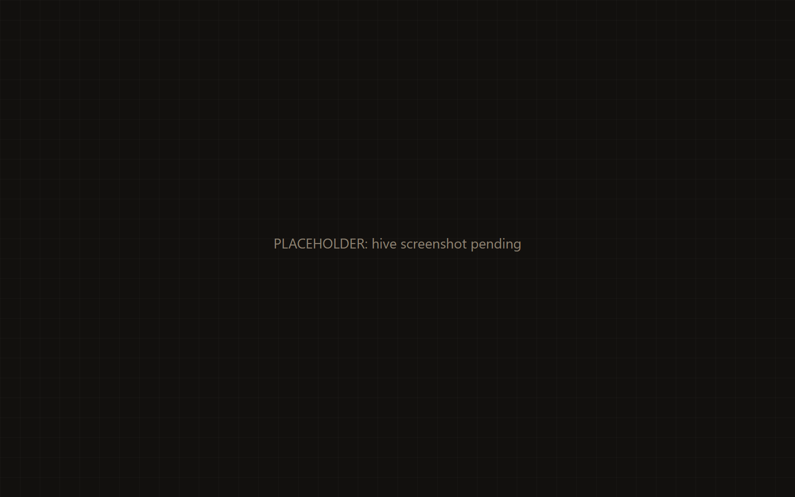

<p align="center">
  
</p>

<p align="center"><b>One command. A whole AI crew on your own machine.</b></p>

<p align="center">
  <a href="https://kwy404.github.io/hivedesk/">Website</a> &middot;
  <a href="#install">Install</a> &middot;
  <a href="#honest-about-the-limits">Limits</a> &middot;
  <a href="#lend-your-pc">Lend your PC</a> &middot;
  <a href="i18n/README.pt-BR.md">Português</a>
</p>

Run `npx hivedesk` and it does the rest: it checks your hardware, installs the local runtime, downloads the right model with a progress bar and opens the Hive in your browser. The Hive is a desktop where a crew of AI workers plans, talks to each other and builds real files in a folder on your computer, with a model that runs on your own machine. No account, no API key.

<p align="center">
  
</p>

## Install

```bash
npx hivedesk
```

That is the whole setup. On the first run, hivedesk:

1. starts a server on `127.0.0.1` with a secret token in the URL and opens your browser, which shows a progress bar while the rest runs;
2. uses Ollama or LM Studio if one of them is already running with a model, and skips the download;
3. detects the hardware: OS, CPU cores, RAM, free disk and the GPU with its VRAM;
4. installs the local runtime `node-llama-cpp` into `~/.hivedesk/runtime/`, once (it is not a dependency of the package, so `npx hivedesk` itself stays small);
5. picks a model from the official Qwen repositories on Hugging Face and downloads it into `~/.hivedesk/models/`, showing its name, size and source; a cut download resumes, and the file is checked against its published SHA-256;
6. loads the model, on the GPU when possible, and the crew says ready.

<p align="center">
  
</p>

| Your hardware | Model (Q4_K_M) | Download |
| --- | --- | --- |
| GPU with 6 GB of VRAM or more | Qwen2.5-Coder 7B Instruct | 4.7 GB |
| GPU with 3.5 GB or more, or no GPU and 16 GB of RAM | Qwen2.5-Coder 3B Instruct | 2.1 GB |
| Anything else | Qwen2.5-Coder 1.5B Instruct | 1.1 GB |

**How long the first run takes.** Mostly the model download, plus a few hundred MB for the runtime. At 100 Mbit/s the 7B model takes about 6 minutes, the 3B about 3 and the 1.5B under 2; at 25 Mbit/s, multiply by four. For reference, the 2.1 GB model took 10 minutes on the connection we tested with. The second run skips the install and the download and is ready in seconds, the time it takes to load the model into memory.

The exact behavior, including what happens when the disk is short, the network drops or the GPU fails, is in [FIRST-RUN.md](FIRST-RUN.md).

### Requirements

- Node.js 18 or newer, on Windows, macOS or Linux.
- Free disk for the model (1.1 to 4.7 GB) plus up to about 0.7 GB for the runtime. If the disk is short, hivedesk picks a smaller model that fits, or stops before downloading.
- A GPU is optional: NVIDIA, Apple Silicon and others through the runtime. Without one it runs on the CPU, slowly.
- A network connection on the first run only.
- A current browser.

### Options

| Flag | What it does |
| --- | --- |
| `--demo` | No model at all: a scripted job replays so you can look around. Every event is labeled as a demo. |
| `--brain ollama`, `--brain lmstudio` | Use that model server and nothing else. |
| `--brain openai --url <url>` | Any OpenAI compatible endpoint, with the key in the env var `HIVEDESK_API_KEY`. |
| `--model <path or uri>` | Use this GGUF file (a local path, or an `hf:` or `https:` URI). |
| `--no-download` | Never download; the Hive offers a download button instead. |
| `--dir <path>` | The folder the crew works in. Default: the current folder. |
| `--port <n>`, `--no-open` | Pick the port; do not open the browser. |
| `--doctor` | Print the checks (Node, GPU, RAM, disk, models found) and exit. |
| `--lend` | Lend your model to a friend (see below). |

`HIVEDESK_HOME` moves the cache folder `~/.hivedesk/`.

## Honest about the limits

A small model on your own machine is private and free to run. It is also slower and less capable than the biggest models in a data center. Please read this before you start.

- **It needs a model.** Without one, nothing is generated. The first run downloads one, 1.1 to 4.7 GB, unless Ollama or LM Studio is already running or you point it at an endpoint with a key.
- **It is slower than it looks in videos.** Workers take turns on one model, so a job takes minutes, not seconds. On the CPU only, the model writes a few tokens per second.
- **It works best with you steering.** Ask for one thing at a time, read the diffs and approve the steps. Large apps in one go are out of reach for a small model.

<p align="center">
  
</p>

| Hardware | Model it runs | Speed | Good for |
| --- | --- | --- | --- |
| No GPU | Qwen2.5-Coder 1.5B, or 3B with 16 GB of RAM | Slow, a few tokens per second | Small, single file tasks. Expect to wait. |
| GPU with 3.5 to 6 GB | Qwen2.5-Coder 3B | Usable | Small tasks, components, scripts, copy. |
| GPU with 6 to 8 GB | Qwen2.5-Coder 7B | Good | Small and medium tasks, with you steering. |
| Bigger GPU, or a key | A bigger model through Ollama, LM Studio or an OpenAI compatible endpoint | Faster | Bigger jobs and longer plans. |

**Great at:** landing pages, small CRUD apps, scripts, UI components, tests, docs and copy, fixing a bug you describe.

**Not great at:** large or complex apps in one go, long jobs without you reading and approving the steps, speed on a machine without a GPU, and anything at all without a model.

**Privacy:** everything stays on your machine. Lend mode only sends model prompts and answers to a friend you paired with: never files, one request at a time, at most 20 per minute. The friend sees every request and can stop at any time. There is no TURN relay built in, so two very strict networks may not connect.

## How the crew works

<p align="center">
  
</p>

Each worker is a window on the Hive with an avatar, a status dot and a live chat.

- **Mel**, the foreman, turns your request into a task graph and assigns it.
- **Dev** writes and edits code in the workspace.
- **Designer** handles layout and styles.
- **QA** runs checks and tests and sends issues back as fix tasks.
- **Writer** does the README, copy and docs.
- **Hire your own**: give a new worker a role, an avatar color and a list of allowed tools.

Workers never use the model at the same time: one shared model, a fair turn scheduler and a visible queue. Their tools only reach the workspace folder (list, read, write, edit, run and preview); commands run with a timeout, an output cap and no network by default. Every write shows as a diff, and approval mode, on by default, makes risky steps wait for your yes. Jobs that end well are saved as playbooks that Mel reuses, and every event goes to an append-only log you can replay.

## Lend your PC

<p align="center">
  
</p>

A friend with a better GPU can lend you their model:

1. The friend runs `npx hivedesk --lend` and gets six words, a QR code and a share link.
2. You enter the words in **Use a friend's PC** (or open the link). The two browsers pair over WebRTC and show the same confirmation words.
3. Your crew sends model turns to the friend's machine. The friend sees every request in a log and can stop lending at any time.

Only prompts and answers travel. The friend's files are never read or written, and yours never leave your machine. Lending is limited to one request at a time, at most 20 requests per minute and prompts up to 120,000 characters. The words work once and expire after 10 minutes. Pairing goes through public MQTT relays that only see a random topic and ciphertext. There is no TURN relay built in, so two very strict networks may not connect.

## Privacy

- The server binds `127.0.0.1` only and checks a secret token on every request.
- No account, no analytics. The network is used for the first run download, for Lend mode, and for a remote endpoint only if you choose one.
- Everything lives in plain files you own: `.hivedesk/` in your folder (`events.jsonl`, `state.json`, `playbooks/`, `workspace/`) and the cache in `~/.hivedesk/`.

To remove hivedesk, delete `~/.hivedesk/` and the `.hivedesk/` folder in your project.

## FAQ

**Do I need an account or an API key?** No. A key is optional, only to use an OpenAI compatible endpoint.

**Can I try it without downloading a model?** Yes: `npx hivedesk --demo` replays a scripted job, labeled as a demo.

**Can I use a model I already have?** Yes: Ollama or LM Studio are picked up when they run, or pass `--model` with a GGUF file.

**Why does a job take minutes?** All workers share one model and take turns. The queue is on screen.

**Can a worker break my computer?** Tools are scoped to the workspace folder, path escapes are refused, commands have a timeout and no network by default, and approval mode makes risky steps wait for you.

## Docs

- [FIRST-RUN.md](FIRST-RUN.md): what the first run does, step by step, and what happens when something fails.
- [PROTOCOL.md](PROTOCOL.md): the contract between the engine, the UI and Lend mode.

## Contributing

Issues and pull requests are welcome. See [CONTRIBUTING.md](CONTRIBUTING.md), the [CHANGELOG](CHANGELOG.md) and the [security policy](SECURITY.md).

## More from kwy404

[Monsoon](https://kwy404.github.io/monsoon/) (the CSS of the Hive and the site), [Voodoo.js](https://kwy404.github.io/Voodoo.js/) (the interactive parts), [kastor](https://kwy404.github.io/kastor/), [fontsketch](https://kwy404.github.io/fontsketch/), [filefinch](https://kwy404.github.io/filefinch/), [howlden](https://kwy404.github.io/howlden/), [installkite](https://kwy404.github.io/installkite/), [a11ymedic](https://kwy404.github.io/a11ymedic/) and [cookieowl](https://kwy404.github.io/cookieowl/).

## License

[MIT](LICENSE). Made by Alexandre Kohler ([GitHub](https://github.com/kwy404), [LinkedIn](https://www.linkedin.com/in/alexandre-silva-173687256/)).
