<p align="center">
  
</p>

<h3 align="center">Your own AI crew, on your own machine. One command away.</h3>

<p align="center">
  <a href="https://kwy404.github.io/hivedesk/"><b>Website</b></a> &middot;
  <a href="#download">Download</a> &middot;
  <a href="https://kwy404.github.io/hivedesk/#film">75 second film</a> &middot;
  <a href="#honest-limits">Limits</a> &middot;
  <a href="https://www.npmjs.com/package/hivedesk">npm</a> &middot;
  <a href="i18n/README.pt-BR.md">Português</a>
</p>

<p align="center">
  <a href="https://www.npmjs.com/package/hivedesk"></a>
  <a href="https://github.com/kwy404/hivedesk/releases/latest"></a>
  <a href="LICENSE"></a>
  
</p>

```bash
npx hivedesk
```

A crew of AI workers (Mel the foreman, Dev, Designer, QA and Writer) that plans, talks and builds real files in a folder on your computer, with a model that runs on your own machine. No account, no API key. New in 0.2.0: **Hive City**, where your agents live, keep their memory and level, work room by room, and can borrow a friend's GPU.

<p align="center">
  
</p>

<table>
  <tr>
    <td width="50%" valign="top"><a href="https://kwy404.github.io/hivedesk/#film"></a></td>
    <td width="50%" valign="top">
      <h3>Watch the 75 second film</h3>
      <p>The real app, start to finish: the wizard picks a model for the GPU, Mel writes a brief, the crew builds, you approve, and the job ends with a better prompt and a pull request.</p>
      <p><a href="https://kwy404.github.io/hivedesk/#film"><b>Play it on the website</b></a>, or get <a href="docs/media/hivedesk.mp4">the MP4</a> with captions in <a href="docs/media/hivedesk.en.vtt">English</a> and <a href="docs/media/hivedesk.pt-BR.vtt">Portuguese</a>.</p>
    </td>
  </tr>
</table>

## Hive City

<p align="center">
  
</p>

<table>
  <tr>
    <td width="33%"><br><sub><b>A friend joins</b> with six words and their machine rises next to yours.</sub></td>
    <td width="33%"><br><sub><b>Borrow a GPU</b> for a set number of turns; either side can stop.</sub></td>
    <td width="33%"><br><sub><b>Agents that stay,</b> with a level, XP, tools and a memory you edit.</sub></td>
  </tr>
</table>

hivedesk now opens on a small city, and the city is the state of the system: every building, room, agent and task you see is an event in the same log the crew writes ([CITY-PROTOCOL.md](CITY-PROTOCOL.md)). `npx hivedesk --demo` plays the city scenario: a friend joins, her building rises, Dev borrows her GPU across the bridge, and a task goes through every room to done.

- **Agents that stay.** Each crew worker is an agent with a home room, a level and XP from finished work, tools, and a private memory you can read, edit and pin. Agents are saved per machine in `~/.hivedesk/city/agents/`, so the same Dev keeps its level in every project, and pinned facts, preferences and decisions go into its prompts.
- **Rooms with rules.** Lobby, Design, Code, Review, Test, Ops and Library. A room decides which tools an agent has while it works there (Review only reads and checks, Ops waits for your approval and is closed to guests). Extensions can add rooms.
- **A task bus.** You put a task in a room or on an agent; idle agents in that room bid for it by skill, level and machine load, and every claim and hop is an event. A task in the Lobby goes to Mel, who plans it into crew tasks. The jobs you type in the top bar work as before, and Mel's planned tasks show up on the board too.
- **Code, Review, Test, with loops.** Design writes a spec, Code runs the crew on it, another agent reviews the diff against the criteria, Test runs the checks. A failed review or test sends the task back to its author with the issues, at most 3 times, then it is blocked. You can approve or send back a task at any hop, and a room can wait for you.
- **Machines and friends.** Your PC is a building with its GPU, model and load. A friend who joins through Code together (six words, QR or link) gets a building of their own and can bring agents that think on their machine. An agent can borrow a friend's GPU for a few turns; the friend accepts, sets the limits, sees every turn and can stop it. Only prompts and answers travel, through the existing lend relay and its limits.
- **It comes back.** Close hivedesk and open it tomorrow: the same agents, levels and memories, and the tasks that were in progress open again in their room.

What it does not do yet: Test runs the static checks (HTML, links, JS syntax, CSS, JSON), not your test suite; for tasks planned by Mel the review is those checks and the crew QA report is the test, so no extra model turns are spent; a friend's agent needs that friend's model to be lent; borrowing has no standing "lend 30 percent" setting, only limits per request; the crew job can finish a moment before the city hops of its last task. `--no-city` turns the city off and keeps the 0.1 desktop.

## What you get

<table>
  <tr>
    <td width="33%" valign="top"><br><b>Prompt refiner</b><br>Mel turns a rough request into a brief (goal, build, constraints, checks). You use it, edit it or keep your words. The report ends with an improved prompt.</td>
    <td width="33%" valign="top"><br><b>You approve the risky steps</b><br>Commands, deletes and changes to files you already had wait for your yes, with the diff in front of you.</td>
    <td width="33%" valign="top"><br><b>Picks the model for you</b><br>Reads your GPU and RAM and downloads the right open source coding model, 0.5B to 14B, or uses a local runtime you already run, or your own key.</td>
  </tr>
  <tr>
    <td valign="top"><br><b>Code together</b><br>A friend joins with six words: same files, both cursors. Their saves wait for your approval as a diff.</td>
    <td valign="top"><br><b>Ship to GitHub</b><br>Branch, commit, push, pull request and CI status, each shown as a plan you confirm. Mel drafts the changelog entry.</td>
    <td valign="top"><br><b>Talk to Mel</b><br>Hold <kbd>Ctrl</kbd> <kbd>Space</kbd>. Before anything that acts, Mel reads the plan and waits for a clear yes.</td>
  </tr>
  <tr>
    <td valign="top"><br><b>Themes and extensions</b><br>Eight themes, a contrast checked editor, or ask the crew to design a theme or build an extension (sandboxed, with permissions).</td>
    <td valign="top"><br><b>Memory and playbooks</b><br>Small, editable notes per project and per person; jobs that went well become playbooks Mel reuses.</td>
    <td valign="top"><br><b>10 languages</b><br>English, Português, Español, Français, Deutsch, Italiano, 日本語, 한국어, 简体中文, Русский. Switches live.</td>
  </tr>
  <tr>
    <td valign="top"><br><b>Office mode and replay</b><br>Watch the crew at their desks, or scrub back to any moment from the append only event log.</td>
    <td valign="top"><br><b>Desktop app</b><br>Downloads for Windows, macOS and Linux with their own Node.js, a tray icon and notifications.</td>
    <td valign="top"><br><b>Stays on your machine</b><br>Bound to 127.0.0.1 with a secret token per run. No account, no analytics.</td>
  </tr>
</table>

<details>
<summary><b>Screenshots</b>: the guided tour, the brief, Code together, GitHub, themes, extensions, memory</summary>

| | |
| --- | --- |
|  |  |
|  |  |
|  |  |
|  |  |

</details>

## Download

| | File | Size | Start |
| --- | --- | --- | --- |
| Windows 10 and 11, x64 | [hivedesk-windows-x64.zip](https://github.com/kwy404/hivedesk/releases/latest/download/hivedesk-windows-x64.zip) | 47 MB | unzip, double click `hivedesk.exe` |
| macOS, Apple Silicon and Intel | [hivedesk-macos-universal.zip](https://github.com/kwy404/hivedesk/releases/latest/download/hivedesk-macos-universal.zip) | 89 MB | unzip, move to Applications, open |
| Linux x64 | [hivedesk-linux-x64.tar.gz](https://github.com/kwy404/hivedesk/releases/latest/download/hivedesk-linux-x64.tar.gz) | 55 MB | `tar -xzf`, then `./hivedesk/hivedesk` |
| Linux x64, one file | [hivedesk-linux-x86_64.AppImage](https://github.com/kwy404/hivedesk/releases/latest/download/hivedesk-linux-x86_64.AppImage) | 52 MB | `chmod +x`, then run it |
| Any system with Node.js 20+ | `npx hivedesk` | small | the wizard does the rest |

The desktop app is not signed yet: Windows SmartScreen ("More info", then "Run anyway") and macOS Gatekeeper (System Settings, Privacy and Security, "Open Anyway") ask once, and it does not update itself. The local model is downloaded on the first run. All files, with `SHA256SUMS.txt`, are on the [releases page](https://github.com/kwy404/hivedesk/releases); [desktop/README.md](desktop/README.md) lists what each package contains.

<details>
<summary><b>What the first run does</b>, the model you get and how long it takes</summary>

1. Starts a server on `127.0.0.1` with a secret token in the URL and opens your browser, which shows a progress bar while the rest runs.
2. Uses a local runtime you already use if it is running with a model, and skips the download.
3. Detects the hardware: OS, CPU cores, RAM, free disk and the GPU with its VRAM.
4. Installs its local runtime into `~/.hivedesk/runtime/`, once. It is not a dependency of the package, so `npx hivedesk` itself stays small.
5. Picks a model and downloads it into `~/.hivedesk/models/`, showing its name, size and source. A cut download resumes, and the file is checked against its published SHA-256.
6. Loads the model, GPU first. If less than half of the layers fit, or free RAM is short, it does not load half a model and freeze your machine: it falls back and says why.

| Your hardware | Model (an open source coding model, 4 bit quantized) | Download | Runs on |
| --- | --- | --- | --- |
| GPU with 10 GB of VRAM or more | 14B | 9.0 GB | GPU |
| GPU with 7 to 10 GB of VRAM | 7B | 4.7 GB | GPU |
| GPU with 4 to 7 GB of VRAM (for example a 6 GB card) | 3B | 2.1 GB | GPU, every layer |
| No usable GPU, 16 GB of RAM or more | 3B | 2.1 GB | CPU |
| No usable GPU, 8 to 16 GB of RAM | 1.5B | 1.1 GB | CPU |
| Under 8 GB of RAM | 0.5B | 0.5 GB | CPU, with a warning that results will be basic |

The choice and the reason are shown in one line, for example "A 6 GB graphics card found: the 3B coding model (2.1 GB), fully on the GPU." Change it in Settings or with `--model 14b|7b|3b|1.5b|0.5b|<path>`. The exact behavior, including what happens when the disk is short, the network drops or the GPU fails, is in [FIRST-RUN.md](FIRST-RUN.md).

**How long the first run takes.** Mostly the model download, plus a few hundred MB for the runtime. At 100 Mbit/s the 3B model takes about 3 minutes and the 7B about 6. After that a run is ready in the time it takes to load the model.

**Requirements**

- Node.js 20 or newer, on Windows, macOS or Linux.
- Disk: 0.5 to 9.0 GB for the model, plus up to about 0.7 GB for the runtime.
- Free RAM to load it: 2.5 GB when the model goes to the GPU; on the CPU, the model size plus 1.5 GB (at least 4 GB).
- A GPU is optional: most modern graphics cards work, and so does Apple Silicon.
- A network connection on the first run.
</details>

<details>
<summary><b>Command line options</b></summary>

| Flag | What it does |
| --- | --- |
| `--yes` | Skip the setup questions (the saved setup, or the recommended defaults). |
| `--demo` | No model at all: a scripted job replays so you can look around. Every event is labeled as a demo. |
| `--model <name or path>` | `14b`, `7b`, `3b`, `1.5b`, `0.5b` or a GGUF file, instead of the automatic choice. |
| `--brain <name>` | Use a local runtime you already run, or a cloud endpoint with `--url`, `--model` and your key in `HIVEDESK_API_KEY`. `hivedesk --help` lists the names. |
| `--no-download` | Never download a model; the Hive offers the download instead. |
| `--cpu`, `--ctx <n>` | Do not use the GPU; set the context size. |
| `--dir <folder>` | The project folder. Files go to `<folder>/.hivedesk/`. |
| `--port <n>`, `--no-open` | Pick the port; do not open the browser. |
| `--lend`, `--join <link or words>` | Lend your model to a friend, or join one (see below). |
| `--doctor` | Check Node, the GPU, RAM, disk and the models, then exit. |
| `--no-city` | Run without Hive City: no agents, rooms or task bus; the rest works the same. |

`HIVEDESK_HOME` moves the cache folder `~/.hivedesk/`.
</details>

<a id="honest-limits"></a>
## Honest about the limits

- **It needs a model.** Without one, nothing is generated. The first run downloads one (0.5 to 9.0 GB) unless a local runtime you already use is running or you add a key.
- **It is slower than it looks in videos.** Workers take turns on one model, so a job takes minutes. On the CPU only, the model writes a few tokens per second.
- **It works best with you steering.** Great at landing pages, small CRUD apps, scripts, components, tests, docs and fixing a bug you describe. Not great at large apps in one go.
- **Privacy has switches.** Your files stay on your machine. The network is used for the first download, then only for what you turn on: Lend mode and Code together, GitHub, cloud providers with your key, extensions from a URL, and the browser's speech recognition in voice mode.

<details>
<summary><b>Hardware, measured speed and the details</b></summary>

<p align="center">
  
</p>

| Hardware | Model it runs | Speed | Good for |
| --- | --- | --- | --- |
| No GPU | A 0.5B or 1.5B coding model, or 3B with 16 GB of RAM | Slow, a few tokens per second | Small, single file tasks. Expect to wait. |
| GPU with 4 to 7 GB | A 3B coding model, fully on the GPU | Usable | Small tasks, components, scripts, copy. |
| GPU with 7 to 10 GB | A 7B coding model | Good | Small and medium tasks, with you steering. |
| 10 GB or more, or a key | A 14B coding model, a bigger one in a local runtime you already use, or a cloud model with your own key | Faster | Bigger jobs and longer plans. |

**Measured** on a 6 GB graphics card from 2016 (Vulkan, 16 GB of RAM) with the 3B fully on the GPU: ready in 8 to 15 seconds from the cache (about 70 seconds on the very first run, including the 2.1 GB download), 17 to 39 tokens per second while writing (4 to 10 on turns that read a long prompt), and a tiny static page (brief, plan, write, QA, report) in about 1.5 to 2.5 minutes after the model was loaded. Results vary between runs: in some runs a worker left a mistake that QA found and the fix rounds could not repair, and the report listed it as missing. The 7B did not fit that card with a 4096 token context, so hivedesk steps down to the 3B on the GPU.
</details>

## Code together and borrowing a GPU

**Code together.** Open the Code window, share six words, and a friend edits the same files with you, cursors and all. Their saves go through your approval mode as a diff, and they never get a shell on your machine.

**Borrow a GPU.** An agent on a busy or small machine asks a friend's machine for a number of turns and minutes. The friend accepts, lowers the limits or refuses, sees every turn and can stop at any time; only prompts and answers travel. A friend can also lend their whole model with `npx hivedesk --lend`.

<details>
<summary><b>GitHub and the changelog</b>, step by step</summary>

Open the **GitHub** window from the dock, or just ask: "connect my GitHub", "create a private repository called shop", "commit and push", "open a pull request", "show the changelog" (Portuguese works too). Mel turns the request into a plan and shows a card with exactly what will happen: repository name, visibility, branch, files, commit message and remote URL. Nothing runs until you press Yes, and you can edit the message, the name and the pull request text on the card.

- **Connect** with your `gh` login (hivedesk asks first and shows the account), or paste a fine-grained token. The window links to the token page and lists the permissions to pick: Contents and Pull requests read and write, Commit statuses and Actions read-only, Administration read and write only if you want hivedesk to create repositories. The token is stored only in `~/.hivedesk/github.json`, readable by your user only, and is never sent to the browser. There is no hivedesk server in between.
- **Work:** list and search your repositories, clone one into an empty workspace, or create a public or private repository from the workspace. After a job, Commit moves the work to a branch named after the job, Mel writes the commit message from the job report, and the pull request body is the job report. The window shows the pull request link and its CI status.
- **git** runs on your machine inside the workspace, without hooks from the workspace and without password prompts. If git is missing, the window says how to install it.
- **Changelog:** when a job ends, Mel drafts an entry in the [Keep a Changelog](https://keepachangelog.com/en/1.1.0/) format (Added, Changed, Fixed) with a suggested version bump and its reason. You edit and approve it, then it goes into the workspace `CHANGELOG.md`, the commit and the pull request. The **Activity** tab shows who did what and when, crew and people (Code together guests by name); click an entry to see the file and its diff, filter it, or export it as CSV, JSON or Markdown.

**Sign in with a code (optional).** The device sign in is off unless you register your own OAuth app, because hivedesk has no client id of its own:

1. On GitHub, open Settings, Developer settings, OAuth Apps, New OAuth App. Any name works; for the homepage and callback URL use `http://127.0.0.1` (the device flow does not call it).
2. In the app settings, tick **Enable Device Flow** and save.
3. Copy the **Client ID** (not a secret) into `~/.hivedesk/config.json`: `{ "github": { "clientId": "<your client id>" } }`, then restart hivedesk.
</details>

## FAQ

<details><summary><b>Do I need an account or an API key?</b></summary>No. Keys are optional, only to add a cloud provider or a compatible endpoint with your own key; they stay in a key store on your machine.</details>
<details><summary><b>Can I look around without downloading a model?</b></summary>Yes: <code>npx hivedesk --demo</code> plays a scripted job and a city scenario, every event labeled as a demo.</details>
<details><summary><b>Can I use a model I already have?</b></summary>Yes: a local runtime you already use is picked up when it runs, or pass <code>--model</code> with a GGUF file.</details>
<details><summary><b>Why does a job take minutes?</b></summary>All workers share one model and take turns. The queue is on screen.</details>
<details><summary><b>I prefer the old desktop.</b></summary>Start with <code>--no-city</code>: no agents, rooms or task bus; the rest works the same.</details>
<details><summary><b>How do I remove it?</b></summary>Delete <code>~/.hivedesk/</code> and the <code>.hivedesk/</code> folder in your project; if you installed it with npm, run <code>npm rm -g hivedesk</code>.</details>

## Docs

[FIRST-RUN.md](FIRST-RUN.md) (the first run, step by step) &middot; [PROTOCOL.md](PROTOCOL.md) (engine, UI and plug-ins) &middot; [CITY-PROTOCOL.md](CITY-PROTOCOL.md) (Hive City) &middot; [CHANGELOG.md](CHANGELOG.md) &middot; [SECURITY.md](SECURITY.md)

## Contributing

Issues and pull requests are welcome. [CONTRIBUTING.md](CONTRIBUTING.md) explains how to run the engine with `--demo`, the tests and the checks. Please keep changes small and honest about what they do; the site and this README describe only what the code does.

## Author

Made by **Alexandre Kohler** &middot; <a href="https://github.com/kwy404" rel="me noopener"> GitHub</a> &middot; <a href="https://www.linkedin.com/in/alexandre-silva-173687256/" rel="me noopener"> LinkedIn</a>

More from kwy404: [Monsoon](https://kwy404.github.io/monsoon/) (the site's CSS), [Voodoo.js](https://kwy404.github.io/Voodoo.js/) (its interactive parts), [kastor](https://kwy404.github.io/kastor/), [fontsketch](https://kwy404.github.io/fontsketch/), [filefinch](https://kwy404.github.io/filefinch/), [howlden](https://kwy404.github.io/howlden/), [installkite](https://kwy404.github.io/installkite/), [a11ymedic](https://kwy404.github.io/a11ymedic/) and [cookieowl](https://kwy404.github.io/cookieowl/).

[MIT](LICENSE). The desktop window uses [Neutralinojs](https://neutralino.js.org/) (MIT).
