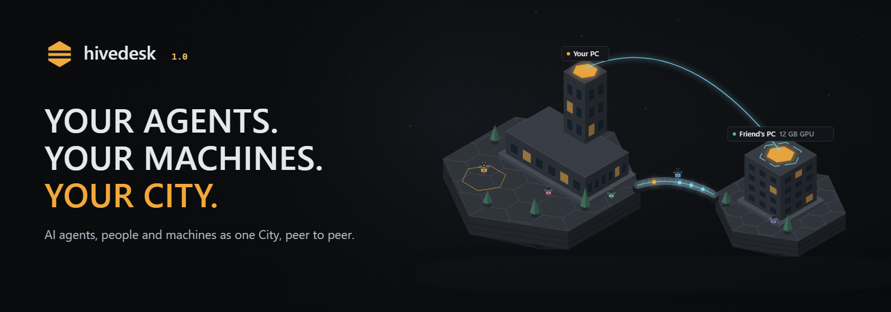
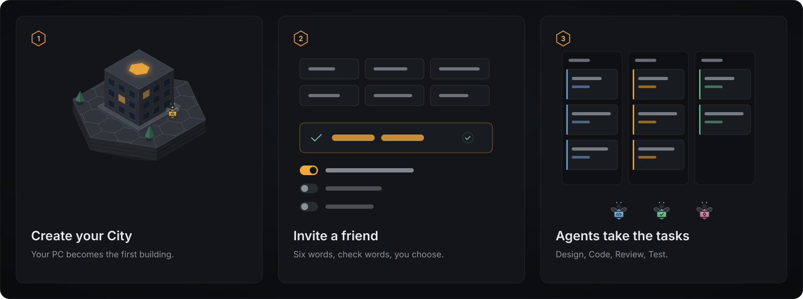
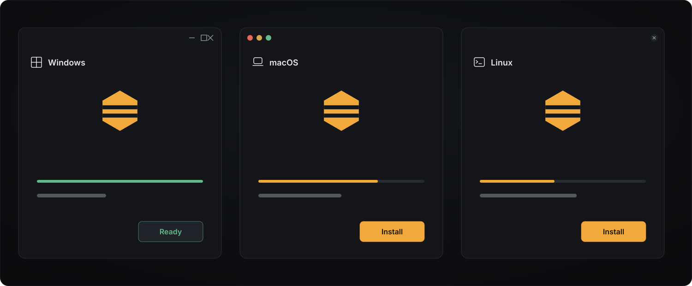
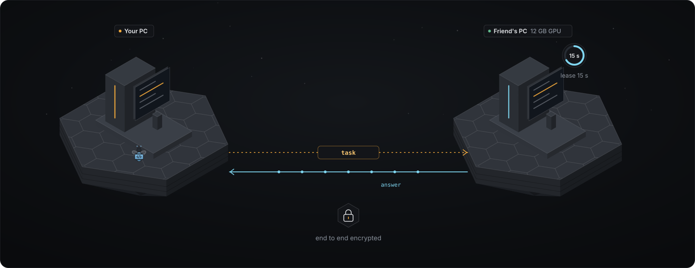
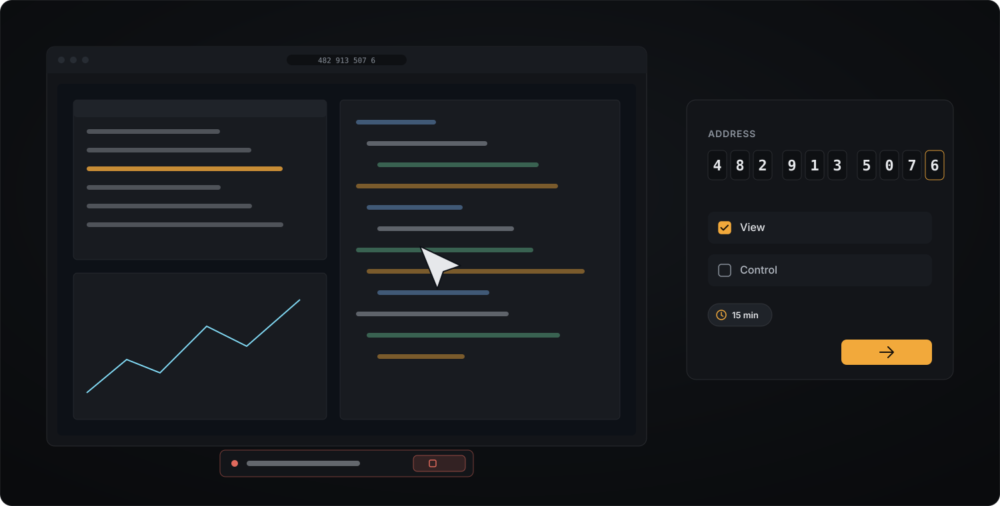

<p align="center">
  
</p>

<p align="center"><a href="https://kwy404.github.io/hivedesk/#film"></a><br><sub><a href="https://kwy404.github.io/hivedesk/#film">Watch the 1.0 film, 3:50</a></sub></p>

<h3 align="center">Your agents. Your machines. Your city.</h3>

<p align="center"><b>hivedesk is a peer-to-peer operating environment where AI agents, people and machines work together as one City.</b></p>

<p align="center">
  <a href="https://kwy404.github.io/hivedesk/"><b>Website</b></a> &middot;
  <a href="#quick-start">Quick Start</a> &middot;
  <a href="#desktop-app-or-browser">App or browser</a> &middot;
  <a href="#security">Security</a> &middot;
  <a href="#honest-limits">Limits</a> &middot;
  <a href="i18n/README.pt-BR.md">Português</a>
</p>

<p align="center">
  <a href="https://www.npmjs.com/package/hivedesk"></a>
  <a href="https://github.com/kwy404/hivedesk/releases/latest"></a>
  <a href="LICENSE"></a>
  
</p>

Your PC is the first building of your City. Friends join with six words and bring their machines. Agents live in the rooms, take the tasks, and think on whichever machine the scheduler picks: your GPU, a friend's GPU they chose to share, or your CPU, always within what each owner allowed, with a reason you can read. Models run on your own machines; no account, no API key.

| | |
| --- | --- |
| **Your PC** | The engine, your workspace, your agents and your own model. |
| **A friend's PC** | A building in your City, with its agents. Shares nothing until its owner says so. |
| **Agents** | Architect, Developer, QA and Reviewer by default, each with a room, tools, a level and a memory. |
| **GPU and CPU** | Lent per job with a lease, limits and a Stop button, separately for the GPU and the CPU. |
| **P2P** | Ed25519 identities, six word invites, check words, end to end encryption, an audit log. |

<table>
  <tr><td align="center" width="16%"><br><sub>A crew of agents</sub></td><td align="center" width="16%"><br><sub>Your City</sub></td><td align="center" width="16%"><br><sub>Machines</sub></td><td align="center" width="16%"><br><sub>Six word invites</sub></td><td align="center" width="16%"><br><sub>Share a GPU</sub></td><td align="center" width="16%"><br><sub>Share a CPU</sub></td></tr>
  <tr><td align="center" width="16%"><br><sub>Remote screen</sub></td><td align="center" width="16%"><br><sub>Clipboard and files</sub></td><td align="center" width="16%"><br><sub>Say it</sub></td><td align="center" width="16%"><br><sub>Code editor</sub></td><td align="center" width="16%"><br><sub>Playbooks</sub></td><td align="center" width="16%"><br><sub>Audit log</sub></td></tr>
</table>

<p align="center">
  
</p>

<a id="quick-start"></a>
## Quick Start

```bash
npx hivedesk            # the engine on your machine, the window in your browser
npx hivedesk --demo     # look around first: a City in a temporary folder, every event labeled
```

Or download the desktop app (recommended, below): it carries its own Node.js and gives you the full experience.

<a id="desktop-app-or-browser"></a>
### Desktop app or browser

The desktop app and `npx hivedesk` run the same engine on your machine; the difference is the window. A web page on its own runs inside the browser's sandbox, so it cannot do any of this.

| Feature | Desktop app (recommended) | Browser tab with `npx hivedesk` | Browser only, nothing installed |
| --- | --- | --- | --- |
| The local model on your GPU | Yes | Yes. The engine runs in Node.js on your machine; the tab only shows it. | No. A web page cannot start a native program or load a model file of several GB from your disk. |
| Sharing your GPU and CPU | Yes, also with the window closed: it keeps running in the tray. | Yes, while the tab stays open. The peer link runs in the window, and browsers slow down or freeze background tabs. | No. There is no engine to share. |
| Remote control | Windows, and Linux on X11. macOS is view only until the app is signed. | Viewing works in Chromium based browsers. Control, the native clipboard and pasted files come from the input helper, the same as in the app. | No. A page cannot move the mouse or press keys on your system. |
| Switching monitors | Yes. The viewer asks, the host picks the screen. | Yes, but the browser asks the host to pick the screen in its own dialog each time: a page may never choose a screen by itself. | No |
| Terminal (PTY) | Yes on Windows and macOS. On Linux when its native part builds, else a basic labeled terminal. | The same: the terminal runs in the engine. | No. A page cannot start a shell. |
| File system access | The folders you add, with a native folder picker. | The same folders. You type the path, because a page gets no native folder picker. | Only files you pick or drop one at a time, as the browser rules say. |
| <kbd>Ctrl</kbd> <kbd>Alt</kbd> <kbd>Del</kbd> | Never sent to a remote machine. Windows reserves it for the secure sign in screen, so hivedesk drops it, and Win+L, on purpose. | Never sent. Your own system also catches it before any page sees it. | No |
| Notifications | System notifications from the app. | After you allow them in the browser, and only while the tab is open; otherwise in the page. | No |
| Running in the background | Yes. Close the window and it stays in the tray, with Open, Pause and Quit. | The engine keeps running in its terminal, but peers need the tab open, and a sleeping tab may stall a lent job. | No. Closing the tab ends it. |

On macOS and Linux a screen share opens in your Chromium based browser, because those system web views cannot capture the screen reliably.

### Download

| | File | Start |
| --- | --- | --- |
| Windows 10 and 11, x64 | [hivedesk-setup.exe](https://github.com/kwy404/hivedesk/releases/latest/download/hivedesk-setup.exe) | run it: it installs for your user, without administrator rights, and downloads the app |
| Windows, offline | [hivedesk-setup-offline.exe](https://github.com/kwy404/hivedesk/releases/latest/download/hivedesk-setup-offline.exe) | the same installer with the app inside, for a machine without a network |
| macOS, Apple Silicon and Intel | [hivedesk-macos.dmg](https://github.com/kwy404/hivedesk/releases/latest/download/hivedesk-macos.dmg) | open it, drag hivedesk to Applications, open |
| Linux x64, one file | [hivedesk-linux-x86_64.AppImage](https://github.com/kwy404/hivedesk/releases/latest/download/hivedesk-linux-x86_64.AppImage) | `chmod +x`, then run it |
| Linux x64, install script | [hivedesk-linux-install.sh](https://github.com/kwy404/hivedesk/releases/latest/download/hivedesk-linux-install.sh) | `sh hivedesk-linux-install.sh`: checks the SHA-256 against `SHA256SUMS.txt`, then installs into `~/.local` without root |
| Debian and Ubuntu | `hivedesk_<version>_amd64.deb` on the [releases page](https://github.com/kwy404/hivedesk/releases/latest) | `sudo apt install ./hivedesk_<version>_amd64.deb` |
| Fedora and other RPM systems | `hivedesk-<version>-1.x86_64.rpm` on the [releases page](https://github.com/kwy404/hivedesk/releases/latest) | `sudo dnf install ./hivedesk-<version>-1.x86_64.rpm` |
| Any system with Node.js 20+ | `npx hivedesk` | the window opens in your browser |

Installed apps update themselves. They check the Ed25519 signature of the update manifest first, then ask: Update now, When I close or Remind me later. The `.deb` and `.rpm` packages show the update command instead, and `npx hivedesk@latest` gets the newest version. The installers are not code signed with paid certificates, so Windows SmartScreen ("More info", then "Run anyway") and macOS Gatekeeper (System Settings, Privacy and Security, "Open Anyway") ask once. A model is downloaded only after you say yes. Sizes and `SHA256SUMS.txt` are on the [releases page](https://github.com/kwy404/hivedesk/releases).

<p align="center">
  
</p>

## The City

<p align="center">
  
</p>

<table>
  <tr>
    <td width="33%"><br><sub><b>Rooms with rules:</b> the tools allowed inside, who is there, the tasks.</sub></td>
    <td width="33%"><br><sub><b>The Office:</b> the same events indoors, with a count of finished tasks.</sub></td>
    <td width="33%"><br><sub><b>Machines:</b> every number has a source, or says not measured.</sub></td>
  </tr>
  <tr>
    <td width="33%"><br><sub><b>Chat:</b> the crew reports in #general and in direct messages.</sub></td>
    <td width="33%"><br><sub><b>Code editor:</b> explorer, tabs, format, save and the run log.</sub></td>
    <td width="33%"><br><sub><b>Remote screen:</b> nothing is allowed until it is ticked.</sub></td>
  </tr>
  <tr>
    <td width="33%"><br><sub><b>Profile:</b> statistics counted from your own logs, nothing estimated.</sub></td>
    <td width="33%"><br><sub><b>On a phone:</b> the City in a 390 px wide window.</sub></td>
    <td width="33%"><br><sub><b>The Office</b> on the same narrow screen.</sub></td>
  </tr>
</table>

The City is the state of the system: buildings are machines, rooms are places with their own tools, and every task walks through the rooms on its way to done. Every number on it is measured, or the panel says it is not measured.

## Create a City

1. Start hivedesk (the app, or `npx hivedesk`). The first screen lets you name your City and choose: look around the demo, use a model you already run, or download one for your hardware, with its size, license and time estimate before anything starts.
2. Your PC becomes the first building, with the rooms Lobby, Design, Code, Review, Test, Ops and Library, and the default crew.
3. `hivedesk city` prints the City from a terminal: buildings, agents, tasks by state and the peers online.

## Invite a Friend

1. Click **Invite a friend** in the City, or run `hivedesk invite`. You get six words. They work once, for 10 minutes.
2. Your friend opens **Join** and types the words (or `hivedesk join "six words"`). The words meet through a relay and set up an encrypted session.
3. Both screens show the same **check words**. If they match, you choose what your friend may do: only **See the City** is ticked by default; bringing a building and agents, using your GPU, or reading the workspace are separate boxes.
4. Accept. Their building rises next to yours. `hivedesk peers` lists known peers and their grants, with `--revoke` and `--block`.

A wrong word burns the invite on the first handshake: make a new one. The terminal pairs over the LAN (`hivedesk invite --lan`); across the internet a window is needed.

## Borrow a GPU

1. The owner turns sharing on, separately for the GPU and the CPU, with limits, in the app or with `hivedesk share --gpu on --max-vram 8GB --max-jobs 1 --max-seconds 120`. Sharing is off by default.
2. The owner grants you compute (the **Use my GPU** box when you join, or later).
3. When a model does not fit on your machine, the scheduler offers the job to your friend's GPU, explains the choice in one sentence, and holds a 15 second lease renewed by heartbeats. The owner's own turns always go first.
4. Either side can stop it. A stopped job keeps its partial answer, and the job card offers Retry locally, Retry another peer, Use partial or Cancel.

<p align="center">
  
</p>

## Create an Agent

Open **Hire** in the dock, give the agent a name, a role and, if you like, a prompt and a specialization. It gets a home room for its role, a level that grows with finished work, the tools of the room it works in, and a private memory you can read, edit and pin. Agents are saved on your machine and come back tomorrow. A friend's agents start with read only tools and think on their own machine.

## Run a Task

Type what you want in the request box, the City box, `#general` or a direct message to an agent, or hold <kbd>Ctrl</kbd> <kbd>Space</kbd> and say it. Mel turns it into a brief and a task graph; each task walks the pipeline: Design, Code, Test, Review. QA runs your project's own `npm test` when there is a test script, and the static checks otherwise. A failure goes back to the author with the issues, at most 3 times. Commands, deletes and remote answers wait for your approval.

<table>
  <tr>
    <td width="40%"><br><sub>Hold <kbd>Ctrl</kbd> <kbd>Space</kbd> and say it.</sub></td>
    <td width="60%"><br><sub>A 10 digit address, view only until control is ticked.</sub></td>
  </tr>
</table>

<p align="center">
  <br>
  <sub><b>Phone remote:</b> scan the QR code in the hivedesk window, then approve, chat and follow jobs from your phone. Each phone has its own grants.</sub>
</p>

## How it works

<details>
<summary><b>Architecture</b></summary>

```text
 window (app or browser tab)  <->  hivedesk engine (Node.js 20, 127.0.0.1, secret token)
                                     core: one event log per project, domain reducers, command router with checks
                                     tasks: one task engine, nine states, history, retry, cancel, reassign
                                     crew and City: agents, rooms, pipeline
                                     p2p: identity, invites, sessions, grants, audit log
                                     compute: probes, share settings, scheduler, leases, worker
                                     workbench: files, search, terminal, source control
                                     remote: screen view and control, clipboard, files
                                           |  encrypted frames: in process, LAN, or through the window
                                     other hivedesk engines
```

The engine is the authority: identity keys, sessions, grants, jobs and the audit log live in Node.js, never in a browser tab. Protocols: [PROTOCOL.md](PROTOCOL.md), [CITY-PROTOCOL.md](CITY-PROTOCOL.md) and [docs/1.0/protocol/](docs/1.0/protocol/).
</details>

<details>
<summary><b>P2P</b></summary>

- One Ed25519 identity per install in `~/.hivedesk/identity/`. The peer id comes from the public key, shown to people as six fingerprint words.
- Invites: six words (66 bits), one use, 10 minutes, burned by the first handshake that starts on them. The handshake uses X25519 with the invite as a pre shared key, both identities sign the transcript, and both screens show six check words before the host accepts.
- Sessions: ChaCha20-Poly1305 with separate streams for control, compute and media, rekeyed every 2^20 messages or 60 minutes, a replay window, and a ping every 5 seconds.
- Transports: LAN (off until you turn it on), and the window's data channel through public relays that only carry ciphertext. Known peers reconnect without words.
- `hivedesk doctor --p2p` checks the identity, the relays, the ports and your network type (open, cone, symmetric or blocked).
</details>

<a id="security"></a>
<details>
<summary><b>Security</b></summary>


- **Default deny.** When a friend joins, only See the City is on. City membership, compute (GPU, CPU, RAM, storage), the workspace, terminal sharing, the screen, the clipboard and files are separate grants with limits. Screen and terminal grants live only for the session, at most 60 minutes.
- **The owner's engine decides.** Every peer command is checked in the engine of the machine that owns the resource. A guest cannot pick your model, open a shell or read a file you did not share.
- **Remote answers are untrusted.** Any tool call that comes from a turn a friend's GPU served needs your approval in every approval mode, new files included.
- **Leases and deadlines.** A lent job has a 15 second lease, a hard deadline, a token limit and runs only on the lender's local model, never on their cloud key or another peer.
- **Audit log.** `~/.hivedesk/audit/`, one hash chained line per join, grant, revoke, job and remote session. It never stores words, keys, prompts or answers.
- Report a vulnerability: [SECURITY.md](SECURITY.md).
</details>

<details>
<summary><b>GPU and CPU workers</b></summary>

- Probes on each machine: the GPU vendor's tool, Windows performance counters, the Linux kernel's files, and on macOS unified memory (utilization is shown as not measured). Every number carries its source; a friend's numbers are labeled as reported by them.
- Share settings, off by default: GPU (most VRAM, jobs at once 1 to 4, longest job, remote inference, model download) and CPU (threads, most RAM), plus hours, a model list and which peers.
- A worker serves only the model it has loaded, never swaps the owner's model, never downloads one for a peer, and refuses anything but an inference job.
</details>

<details>
<summary><b>Scheduler</b></summary>

For each job it lists the candidates (your GPU, your CPU, each friend that granted you compute), drops the ones that fail a hard rule (grant, sharing, model, memory, capacity, time) with the reason, estimates the time from measured speeds, prefers local work, and picks the lowest. The reason is one sentence on the job card and the City bridge, for example: "Ana's PC, GPU: the 7B model fits in the 8 GB she shares, about 14 s. Your GPU has 3.2 GB free and the model needs 5.4 GB; your CPU would take about 52 s." With no candidate the task waits for a resource and lists the reasons.
</details>

<details>
<summary><b>Agents and the City</b></summary>

- Agents: a role (Architect, Developer, QA, Reviewer, Planner, Writer, Designer or your own), a home room, where they think (local, a peer or a cloud key), tools and permissions, a level and history from finished work, and a memory of short entries.
- Rooms cut an agent's tools to the room's while it works there. Ops is for the host only. Extensions can add rooms.
- Tasks have nine states (queued, assigned, working, waiting, review, testing, completed, failed, cancelled) with a history of every change and a deadline on every wait.
- The Machines panel, the Activity stream and the job, task and peer panels read the same store. Office mode shows the same events as a honeycomb office.
</details>

<details>
<summary><b>Workbench</b></summary>

Folders you add next to the crew's workspace (each one a grant you can remove), an explorer with create, rename, move and delete, tabs in up to three split groups, diagnostics and symbols for JavaScript and TypeScript, search and replace across files with a diff preview, a real terminal (Windows and macOS; on Linux when its native part builds, else a labeled basic terminal), source control (status, diff, stage, commit, branches, stashes, log), terminal sharing for 5, 15 or 60 minutes, and Code together over the encrypted session. Agents never get a terminal.
</details>

<details>
<summary><b>Remote desktop</b></summary>

A 10 digit address (not a password) finds a machine while "Let partners reach this computer" is on, which is off by default. The host sees the caller's name and check words with a 60 second countdown; every box starts unticked (view, control, clipboard, files) and grants last 5, 15 or 60 minutes. A banner with Stop, <kbd>Ctrl</kbd> <kbd>Alt</kbd> <kbd>Shift</kbd> <kbd>K</kbd> on Windows, no input while the screen is locked, several screens, quality presets, chat, clipboard text and images, files up to 2 GB with resume, and unattended access for known peers with a password (5 wrong tries lock it for 15 minutes). Control works on Windows and on Linux X11 with xdotool and loginctl; macOS and Wayland are view only in 1.0.

A phone can be a remote too: pair it with the QR code in the hivedesk window, accept it on the desktop, then approve, chat and follow jobs from the phone. Every phone has its own grants (only the status is on at first), a removal applies at once, and the hivedesk window must stay open.
</details>

<details>
<summary><b>Models</b></summary>

A catalog of 57 open source models from 0.5B to 72B parameters, for coding, reasoning and chat, each in quantized files from 2 to 8 bits, with their licenses. hivedesk recommends one for your hardware and asks before any download. A pool meter shows how close your City is to running a giant model with friends' shared memory, and an experimental switch, off by default, runs one model across the machines of friends who granted it, over the encrypted p2p link. Its speed depends on the network link between the machines. About 500 expert playbooks (pages, components, data, tests, reviews, git and docs) are picked per task by relevance, and their checks run in QA.

| Your hardware | Model it runs | Speed | Good for |
| --- | --- | --- | --- |
| No GPU | A 0.5B or 1.5B coding model, or 3B with 16 GB of RAM | Slow, a few tokens per second | Small, single file tasks. Expect to wait. |
| GPU with 4 to 7 GB | A 3B coding model, fully on the GPU | Usable | Small tasks, components, scripts, copy. |
| GPU with 7 to 10 GB, or a friend's | A 7B coding model | Good | Small and medium tasks, with you steering. |
| 10 GB or more, or a key | A 14B coding model, a bigger one in a local runtime you already use, or a cloud model with your own key | Faster | Bigger jobs and longer plans. |
</details>

<details>
<summary><b>Development</b></summary>

```bash
git clone https://github.com/kwy404/hivedesk && cd hivedesk
npm install
npm run demo                                          # the engine with a scripted City
npx vitest run --pool=threads --maxWorkers=2          # the tests
npm run lint && npm run rules && npm run site         # the checks
python docs/_i18n/check.py                            # the site in 10 languages
```

Ownership, contracts and the test plan are in [docs/1.0/PLAN.md](docs/1.0/PLAN.md); [CONTRIBUTING.md](CONTRIBUTING.md) has the rest.
</details>

<a id="honest-limits"></a>
## Honest about the limits

- **Peers need a window.** Across the internet the peer link runs in the app window or a browser tab; a headless peer needs a native WebRTC part that is not built yet. On the same network, `hivedesk invite --lan` works from a terminal.
- **No TURN relay.** Two very strict networks may not connect; `hivedesk doctor --p2p` tells which side is the problem.
- **Not signed yet.** The downloads are not code signed or notarized, so macOS remote control is view only and your system warns before the first run.
- **One model per lender.** A friend's machine serves only the model it has loaded and never downloads one for a peer.
- **Giant models are experimental.** Pooling one model across friends' machines over the encrypted p2p link is in 1.0, off by default, and its speed depends on the network link between the machines.
- **Small models are slow.** Workers take turns on one model, so a job takes minutes; on the CPU only, a few tokens per second.

## FAQ

<details><summary><b>Do I need an account or an API key?</b></summary>No. Models run on your own machines and friends connect to you directly. A key is optional, only for a cloud model of your choice; it stays in a key store on your machine.</details>
<details><summary><b>Can a friend see my files?</b></summary>Only if you tick Read the workspace for them. Edits they propose wait for your approval, new files included.</details>
<details><summary><b>What does a friend's GPU see when I borrow it?</b></summary>The prompts and answers of the jobs sent to it, nothing else: no files, tools or memory.</details>
<details><summary><b>Do I need the desktop app?</b></summary>No. <code>npx hivedesk</code> runs the same engine; the <a href="#desktop-app-or-browser">table above</a> lists every difference.</details>
<details><summary><b>Can someone take over my screen?</b></summary>Not without your click: off by default, view only by default, every grant expires, a locked screen takes no input, and one hotkey or Stop ends it all.</details>
<details><summary><b>How do I remove it?</b></summary>Delete <code>~/.hivedesk/</code> (identity, known peers, runtime, models, settings) and the <code>.hivedesk/</code> folder in your project; if you installed it with npm, run <code>npm rm -g hivedesk</code>.</details>

## Docs

[FIRST-RUN.md](FIRST-RUN.md) &middot; [PROTOCOL.md](PROTOCOL.md) &middot; [CITY-PROTOCOL.md](CITY-PROTOCOL.md) &middot; [docs/1.0/protocol/](docs/1.0/protocol/) &middot; [CHANGELOG.md](CHANGELOG.md) &middot; [SECURITY.md](SECURITY.md)

## Author

Made by **Alexandre Kohler** &middot; <a href="https://github.com/kwy404" rel="me noopener"> GitHub</a> &middot; <a href="https://www.linkedin.com/in/alexandre-silva-173687256/" rel="me noopener"> LinkedIn</a>

[MIT](LICENSE). The desktop window uses [Neutralinojs](https://neutralino.js.org/) (MIT).
