<p align="center">
  
</p>

<h3 align="center">Sua própria equipe de IA, no seu computador. A um comando de distância.</h3>

<p align="center">
  <a href="https://kwy404.github.io/hivedesk/"><b>Site</b></a> &middot;
  <a href="#baixar">Baixar</a> &middot;
  <a href="https://kwy404.github.io/hivedesk/#film">Filme de 75 segundos</a> &middot;
  <a href="#limites">Limites</a> &middot;
  <a href="https://www.npmjs.com/package/hivedesk">npm</a> &middot;
  <a href="../README.md">English</a>
</p>

<p align="center">
  <a href="https://www.npmjs.com/package/hivedesk"></a>
  <a href="https://github.com/kwy404/hivedesk/releases/latest"></a>
  <a href="../LICENSE"></a>
  
</p>

```bash
npx hivedesk
```

Uma equipe de agentes de IA (Mel, a mestre de obras, Dev, Designer, QA e Writer) que planeja, conversa e cria arquivos de verdade numa pasta do seu computador, com um modelo que roda na sua própria máquina. Sem conta e sem chave de API. Novo na 0.2.0: a **Hive City**, onde os seus agentes vivem, guardam memória e nível, trabalham sala por sala e podem pegar emprestada a GPU de um amigo.

<p align="center">
  
</p>

<table>
  <tr>
    <td width="50%" valign="top"><a href="https://kwy404.github.io/hivedesk/#film">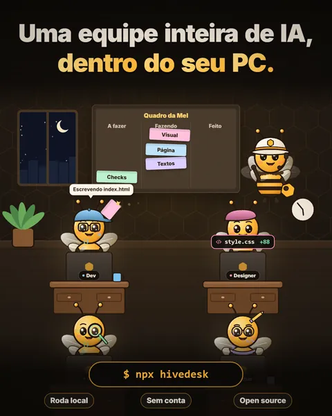</a></td>
    <td width="50%" valign="top">
      <h3>Assista ao filme de 75 segundos</h3>
      <p>O app de verdade, do começo ao fim: o assistente escolhe o modelo para a GPU, a Mel escreve o briefing, a equipe constrói, você aprova, e o trabalho termina com um prompt melhor e um pull request.</p>
      <p><a href="https://kwy404.github.io/hivedesk/#film"><b>Assista no site</b></a>, ou baixe <a href="../docs/media/hivedesk.mp4">o MP4</a> com legendas em <a href="../docs/media/hivedesk.pt-BR.vtt">português</a> e <a href="../docs/media/hivedesk.en.vtt">inglês</a>.</p>
    </td>
  </tr>
</table>

## Hive City

<p align="center">
  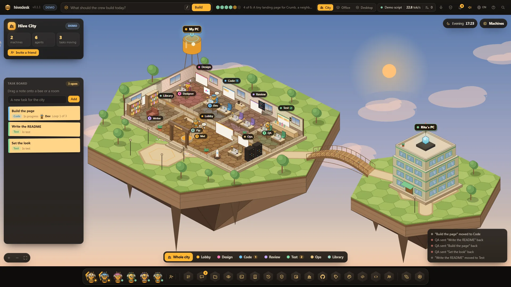
</p>

<table>
  <tr>
    <td width="33%">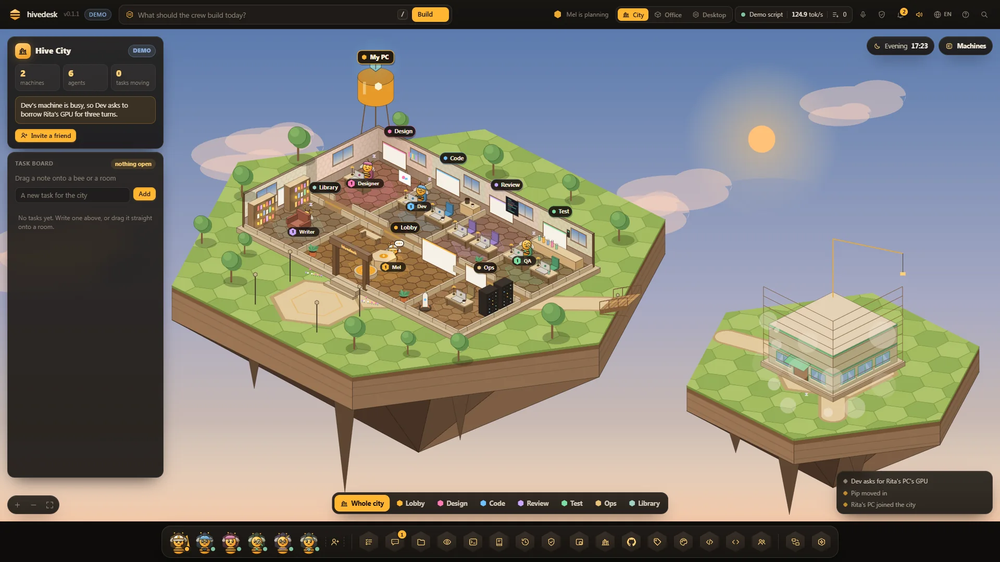<br><sub><b>Um amigo entra</b> com seis palavras e a máquina dele sobe ao lado da sua.</sub></td>
    <td width="33%">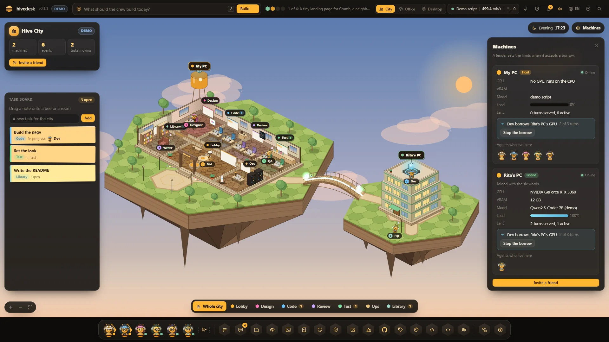<br><sub><b>GPU emprestada</b> por um número de turnos; qualquer lado pode parar.</sub></td>
    <td width="33%">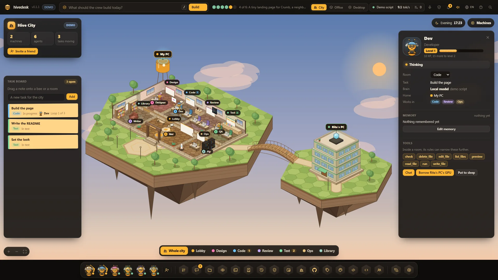<br><sub><b>Agentes que ficam,</b> com nível, XP, ferramentas e uma memória que você edita.</sub></td>
  </tr>
</table>

O hivedesk agora abre numa pequena cidade, e a cidade é o estado do sistema: cada prédio, sala, agente e tarefa que você vê é um evento no mesmo log que a equipe escreve ([CITY-PROTOCOL.md](../CITY-PROTOCOL.md), em inglês). `npx hivedesk --demo` mostra o cenário: uma amiga entra, o prédio dela sobe, o Dev pega a GPU dela emprestada pela ponte e uma tarefa passa por todas as salas até o fim.

- **Agentes que ficam.** Cada membro da equipe é um agente com sala de origem, nível e XP ganhos com trabalho concluído, ferramentas e uma memória própria (até 40 entradas curtas) que você lê, edita e fixa. Eles ficam salvos por máquina em `~/.hivedesk/city/agents/`, então o mesmo Dev mantém o nível em todos os projetos.
- **Salas com regras.** Lobby, Design, Code, Review, Test, Ops e Library. Enquanto um agente trabalha numa sala, as ferramentas dele se limitam às da sala (Review só lê e confere, Ops espera a sua aprovação e é fechada para convidados). Extensões podem criar salas.
- **Um barramento de tarefas.** Você coloca uma tarefa numa sala ou num agente; agentes livres disputam por especialidade, nível e carga da máquina, e cada passo vira um evento. Uma tarefa no Lobby vai para a Mel, que a divide em tarefas da equipe.
- **Code, Review, Test, com voltas.** Design escreve a especificação, Code roda a equipe, outro agente revisa o diff contra os critérios e Test roda as verificações. Uma revisão ou teste que falha devolve a tarefa ao autor com os problemas, no máximo 3 vezes; depois ela fica bloqueada. Você pode aprovar ou devolver em qualquer etapa.
- **Máquinas e amigos.** O seu PC é um prédio com GPU, modelo e carga. Um amigo que entra pelo Code together (seis palavras, QR ou link) ganha um prédio e pode trazer agentes que pensam na máquina dele. Um agente pode pegar a GPU de um amigo emprestada por alguns turnos; o amigo aceita, define os limites, vê cada turno e pode parar. Só prompts e respostas viajam.
- **Tudo volta.** Feche o hivedesk e abra amanhã: os mesmos agentes, níveis e memórias, e as tarefas em andamento reabrem na sala delas.

O que ainda não faz: o Test roda as verificações estáticas (HTML, links, sintaxe de JS, CSS, JSON), não a sua suíte de testes; o agente de um amigo precisa do modelo desse amigo emprestado; o empréstimo não tem uma porcentagem fixa, só limites por pedido. `--no-city` desliga a cidade e mantém a área de trabalho da 0.1.

## O que vem junto

<table>
  <tr>
    <td width="33%" valign="top"><br><b>Refinador de prompt</b><br>A Mel transforma um pedido solto num briefing (objetivo, o que construir, restrições, verificações). Você usa, edita ou fica com as suas palavras. O relatório termina com um prompt melhor.</td>
    <td width="33%" valign="top"><br><b>Você aprova os passos arriscados</b><br>Comandos, exclusões e mudanças em arquivos que você já tinha esperam o seu sim, com o diff na sua frente.</td>
    <td width="33%" valign="top"><br><b>Escolhe o modelo por você</b><br>Lê a sua GPU e a RAM e baixa o modelo de código aberto certo, de 0.5B a 14B, ou usa um runtime local que você já roda, ou a sua chave.</td>
  </tr>
  <tr>
    <td valign="top"><br><b>Code together</b><br>Um amigo entra com seis palavras: mesmos arquivos, os dois cursores. Os salvamentos dele esperam a sua aprovação, como diff.</td>
    <td valign="top"><br><b>Entrega no GitHub</b><br>Branch, commit, push, pull request e status do CI, cada um como um plano que você confirma. A Mel rascunha o changelog.</td>
    <td valign="top"><br><b>Fale com a Mel</b><br>Segure <kbd>Ctrl</kbd> <kbd>Space</kbd>. Antes de qualquer coisa que age, a Mel lê o plano e espera um sim claro.</td>
  </tr>
  <tr>
    <td valign="top"><br><b>Temas e extensões</b><br>Oito temas, um editor com verificação de contraste, ou peça para a equipe criar um tema ou uma extensão (em sandbox, com permissões).</td>
    <td valign="top"><br><b>Memória e playbooks</b><br>Notas pequenas e editáveis por projeto e por pessoa; trabalhos que deram certo viram playbooks que a Mel reaproveita.</td>
    <td valign="top"><br><b>10 idiomas</b><br>English, Português, Español, Français, Deutsch, Italiano, 日本語, 한국어, 简体中文, Русский. Troca na hora.</td>
  </tr>
  <tr>
    <td valign="top"><br><b>Modo escritório e replay</b><br>Veja a equipe nas mesas, ou volte a qualquer momento pelo log de eventos.</td>
    <td valign="top"><br><b>App de desktop</b><br>Downloads para Windows, macOS e Linux com o próprio Node.js, ícone na bandeja e notificações.</td>
    <td valign="top"><br><b>Fica na sua máquina</b><br>Só em 127.0.0.1, com um token secreto por execução. Sem conta, sem analytics.</td>
  </tr>
</table>

<details>
<summary><b>Telas</b>: o tour guiado, o briefing, Code together, GitHub, temas, extensões, memória</summary>

| | |
| --- | --- |
| 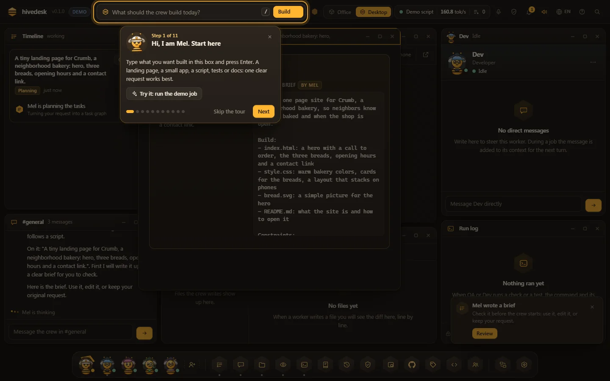 | 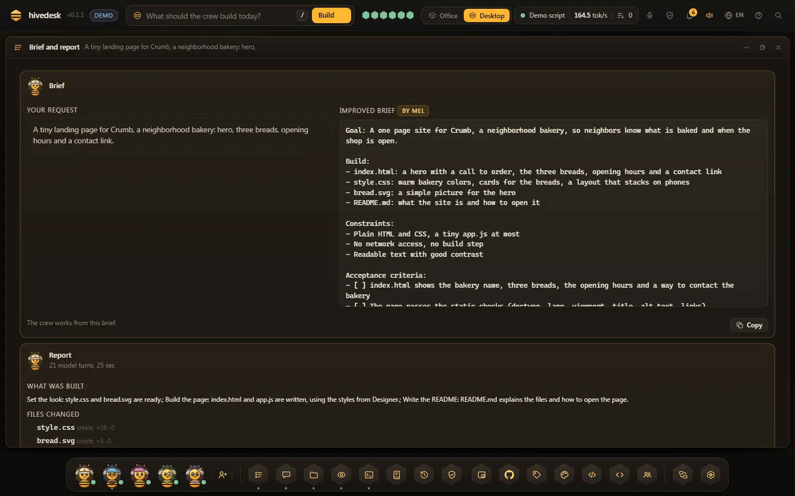 |
| 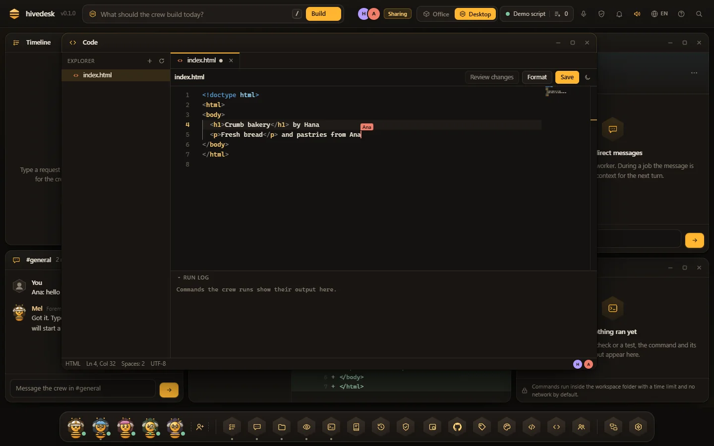 | 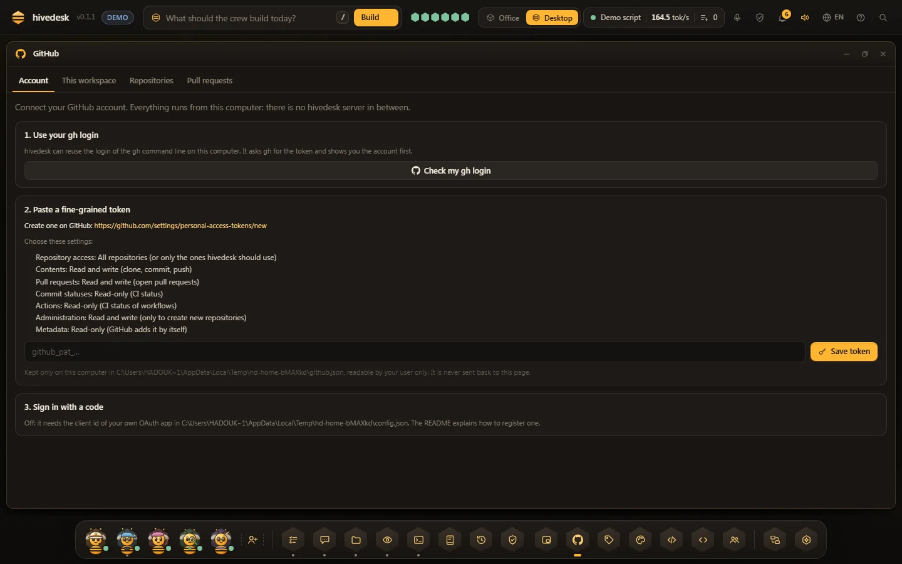 |
| 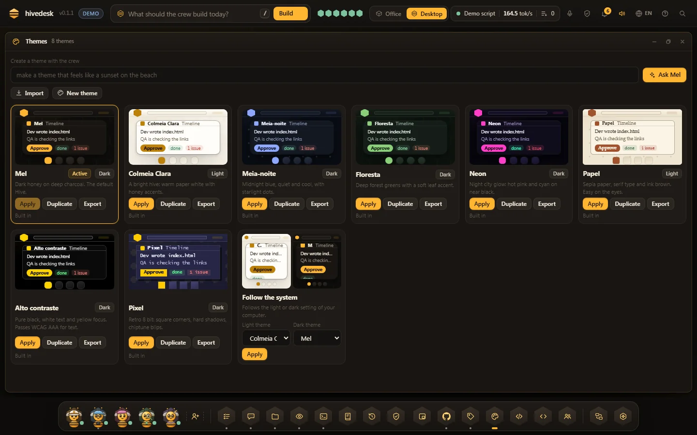 | 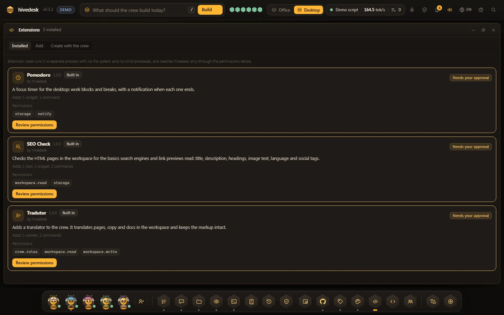 |
| 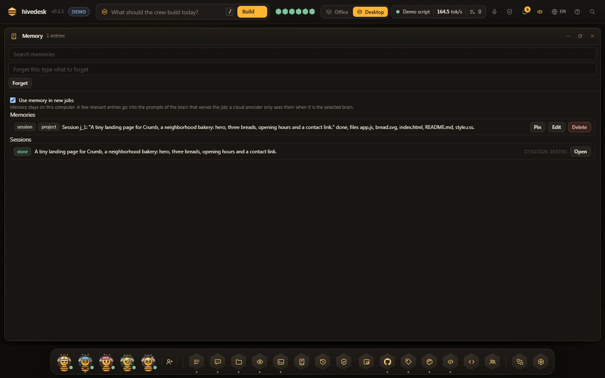 | 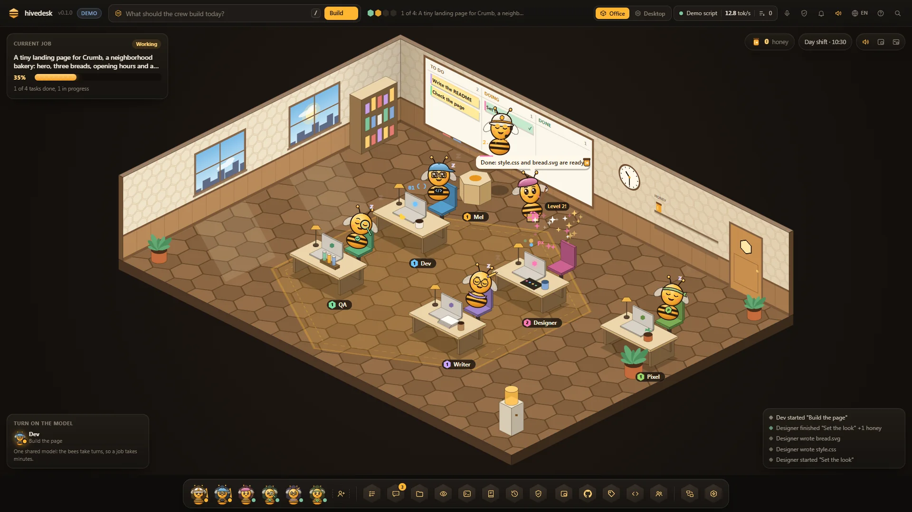 |

</details>

<a id="baixar"></a>
## Baixar

| | Arquivo | Tamanho | Como abrir |
| --- | --- | --- | --- |
| Windows 10 e 11, x64 | [hivedesk-windows-x64.zip](https://github.com/kwy404/hivedesk/releases/latest/download/hivedesk-windows-x64.zip) | 47 MB | descompacte e clique duas vezes em `hivedesk.exe` |
| macOS, Apple Silicon e Intel | [hivedesk-macos-universal.zip](https://github.com/kwy404/hivedesk/releases/latest/download/hivedesk-macos-universal.zip) | 89 MB | descompacte, mova para Aplicativos e abra |
| Linux x64 | [hivedesk-linux-x64.tar.gz](https://github.com/kwy404/hivedesk/releases/latest/download/hivedesk-linux-x64.tar.gz) | 55 MB | `tar -xzf`, depois `./hivedesk/hivedesk` |
| Linux x64, um arquivo só | [hivedesk-linux-x86_64.AppImage](https://github.com/kwy404/hivedesk/releases/latest/download/hivedesk-linux-x86_64.AppImage) | 52 MB | `chmod +x` e rode |
| Qualquer sistema com Node.js 20+ | `npx hivedesk` | pequeno | o assistente faz o resto |

O app de desktop ainda não é assinado: o SmartScreen do Windows ("Mais informações", depois "Executar assim mesmo") e o Gatekeeper do macOS (Ajustes do Sistema, Privacidade e Segurança, "Abrir Mesmo Assim") perguntam uma vez, e ele não se atualiza sozinho. O modelo local é baixado na primeira execução. Todos os arquivos, com o `SHA256SUMS.txt`, estão na [página de versões](https://github.com/kwy404/hivedesk/releases).

<details>
<summary><b>O que a primeira execução faz</b>, o modelo que você recebe e quanto tempo leva</summary>

1. Inicia um servidor em `127.0.0.1` com um token secreto na URL e abre o navegador, que mostra uma barra de progresso enquanto o resto acontece.
2. Usa um runtime local que você já usa, se estiver rodando com um modelo, e pula o download.
3. Detecta o hardware: sistema, núcleos da CPU, RAM, disco livre e a GPU com a VRAM.
4. Instala o próprio runtime local em `~/.hivedesk/runtime/`, uma vez só.
5. Escolhe um modelo e baixa em `~/.hivedesk/models/`, mostrando nome, tamanho e origem. Um download interrompido continua de onde parou, e o arquivo é conferido com o SHA-256 publicado.
6. Carrega o modelo, primeiro na GPU. Se menos da metade das camadas cabe, ou falta RAM livre, ele não carrega meio modelo nem trava o computador: escolhe outro caminho e explica por quê.

| Seu hardware | Modelo (um modelo de código aberto para programação, quantizado em 4 bits) | Download | Roda em |
| --- | --- | --- | --- |
| GPU com 10 GB de VRAM ou mais | 14B | 9,0 GB | GPU |
| GPU com 7 a 10 GB de VRAM | 7B | 4,7 GB | GPU |
| GPU com 4 a 7 GB de VRAM (por exemplo uma placa de 6 GB) | 3B | 2,1 GB | GPU, todas as camadas |
| Sem GPU utilizável, 16 GB de RAM ou mais | 3B | 2,1 GB | CPU |
| Sem GPU utilizável, 8 a 16 GB de RAM | 1.5B | 1,1 GB | CPU |
| Menos de 8 GB de RAM | 0.5B | 0,5 GB | CPU, com um aviso de que o resultado será básico |

A escolha e o motivo aparecem numa linha. Mude em Settings ou com `--model 14b|7b|3b|1.5b|0.5b|<caminho>`. O comportamento exato, inclusive quando falta disco, a rede cai ou a GPU falha, está no [FIRST-RUN.md](../FIRST-RUN.md) (em inglês).

**Quanto tempo leva a primeira execução.** Quase tudo é o download do modelo, mais algumas centenas de MB do runtime. A 100 Mbit/s, o modelo 3B leva uns 3 minutos e o 7B uns 6. Depois disso, cada execução fica pronta no tempo de carregar o modelo.

**Requisitos**

- Node.js 20 ou mais novo, no Windows, macOS ou Linux.
- Disco: 0,5 a 9,0 GB para o modelo e até uns 0,7 GB para o runtime.
- RAM livre para carregar: 2,5 GB quando o modelo vai para a GPU; na CPU, o tamanho do modelo mais 1,5 GB (no mínimo 4 GB).
- GPU é opcional: a maioria das placas de vídeo modernas funciona, e o Apple Silicon também.
- Internet na primeira execução.
</details>

<details>
<summary><b>Opções da linha de comando</b></summary>

| Opção | O que faz |
| --- | --- |
| `--yes` | Pula as perguntas (a configuração salva, ou os padrões recomendados). |
| `--demo` | Sem modelo: um trabalho roteirizado é reproduzido para você conhecer. Todo evento aparece marcado como demo. |
| `--model <nome ou caminho>` | `14b`, `7b`, `3b`, `1.5b`, `0.5b` ou um arquivo GGUF. |
| `--brain <nome>` | Usa um runtime local que você já roda, ou um endpoint na nuvem com `--url`, `--model` e a sua chave em `HIVEDESK_API_KEY`. `hivedesk --help` lista os nomes. |
| `--no-download` | Nunca baixa um modelo; a Colmeia oferece o download. |
| `--cpu`, `--ctx <n>` | Não usa a GPU; define o tamanho do contexto. |
| `--dir <pasta>` | A pasta do projeto. Os arquivos vão para `<pasta>/.hivedesk/`. |
| `--port <n>`, `--no-open` | Escolhe a porta; não abre o navegador. |
| `--lend`, `--join <link ou palavras>` | Empresta o seu modelo a um amigo, ou usa o de um amigo. |
| `--no-city` | Roda sem a Hive City: sem agentes, salas ou barramento de tarefas; o resto funciona igual. |
| `--doctor` | Confere Node, GPU, RAM, disco e modelos, e sai. |
</details>

<a id="limites"></a>
## Sincero sobre os limites

- **Precisa de um modelo.** Sem modelo, nada é gerado. A primeira execução baixa um (0,5 a 9,0 GB), a não ser que um runtime local que você já usa esteja rodando ou você adicione uma chave.
- **É mais lento do que parece nos vídeos.** A equipe reveza um único modelo, então um trabalho leva minutos. Só com a CPU, o modelo escreve poucos tokens por segundo.
- **Funciona melhor com você no comando.** Muito bom em landing pages, pequenos apps CRUD, scripts, componentes, testes, documentação e em corrigir um bug que você descreve. Não é bom em apps grandes de uma vez só.
- **A privacidade tem chaves.** Os seus arquivos ficam na sua máquina. A rede é usada no primeiro download e depois só para o que você liga: modo Emprestar e Code together, GitHub, provedores na nuvem com a sua chave, extensões de uma URL e o reconhecimento de voz do navegador.

<details>
<summary><b>Hardware e os detalhes</b></summary>

<p align="center">
  
</p>

| Hardware | Modelo que roda | Velocidade | Bom para |
| --- | --- | --- | --- |
| Sem GPU | Um modelo de código 0.5B ou 1.5B, ou 3B com 16 GB de RAM | Lento, poucos tokens por segundo | Tarefas pequenas, de um arquivo. Tenha paciência. |
| GPU de 4 a 7 GB | Um modelo de código 3B, inteiro na GPU | Usável | Tarefas pequenas, componentes, scripts, textos. |
| GPU de 7 a 10 GB | Um modelo de código 7B | Bom | Tarefas pequenas e médias, com você no comando. |
| 10 GB ou mais, ou uma chave | Um modelo de código 14B, um maior num runtime local que você já usa, ou um modelo na nuvem com a sua chave | Mais rápido | Trabalhos maiores e planos mais longos. |
</details>

## Code together e GPU emprestada

**Code together.** Abra a janela de código, compartilhe seis palavras, e um amigo edita os mesmos arquivos com você, com os dois cursores. Os salvamentos dele passam pelo seu modo de aprovação como diff, e ele nunca recebe um terminal na sua máquina.

**GPU emprestada.** Um agente numa máquina ocupada ou pequena pede à máquina de um amigo um número de turnos e minutos. O amigo aceita, reduz os limites ou recusa, vê cada turno e pode parar quando quiser; só prompts e respostas viajam. Um amigo também pode emprestar o modelo inteiro com `npx hivedesk --lend`.

## Perguntas frequentes

<details><summary><b>Preciso de conta ou chave de API?</b></summary>Não. Chaves são opcionais, só para um provedor na nuvem ou um endpoint compatível, com a sua chave; ficam guardadas na sua máquina.</details>
<details><summary><b>Dá para testar sem baixar um modelo?</b></summary>Sim: <code>npx hivedesk --demo</code> mostra um trabalho roteirizado e um cenário da cidade, tudo marcado como demo.</details>
<details><summary><b>Posso usar um modelo que já tenho?</b></summary>Sim: um runtime local que você já usa é detectado quando está rodando, ou use <code>--model</code> com um arquivo GGUF.</details>
<details><summary><b>Por que um trabalho leva minutos?</b></summary>A equipe inteira divide um modelo e reveza os turnos. A fila aparece na tela.</details>
<details><summary><b>Prefiro a área de trabalho antiga.</b></summary>Comece com <code>--no-city</code>: sem agentes, salas ou barramento de tarefas; o resto funciona igual.</details>
<details><summary><b>Como removo?</b></summary>Apague <code>~/.hivedesk/</code> e a pasta <code>.hivedesk/</code> do projeto; se instalou pelo npm, rode <code>npm rm -g hivedesk</code>.</details>

## Documentação

[FIRST-RUN.md](../FIRST-RUN.md) (a primeira execução, passo a passo) &middot; [PROTOCOL.md](../PROTOCOL.md) (motor, interface e plug-ins) &middot; [CITY-PROTOCOL.md](../CITY-PROTOCOL.md) (Hive City) &middot; [CHANGELOG.md](../CHANGELOG.md) &middot; [SECURITY.md](../SECURITY.md). Todos em inglês.

## Contribuindo

Issues e pull requests são bem-vindos. O [CONTRIBUTING.md](../CONTRIBUTING.md) explica como rodar o motor com `--demo`, os testes e as verificações. Mantenha as mudanças pequenas e sinceras sobre o que fazem; o site e este README descrevem só o que o código faz.

## Autor

Feito por **Alexandre Kohler** &middot; <a href="https://github.com/kwy404" rel="me noopener"> GitHub</a> &middot; <a href="https://www.linkedin.com/in/alexandre-silva-173687256/" rel="me noopener"> LinkedIn</a>

Mais de kwy404: [Monsoon](https://kwy404.github.io/monsoon/) (o CSS do site), [Voodoo.js](https://kwy404.github.io/Voodoo.js/) (as partes interativas), [kastor](https://kwy404.github.io/kastor/), [fontsketch](https://kwy404.github.io/fontsketch/), [filefinch](https://kwy404.github.io/filefinch/), [howlden](https://kwy404.github.io/howlden/), [installkite](https://kwy404.github.io/installkite/), [a11ymedic](https://kwy404.github.io/a11ymedic/) e [cookieowl](https://kwy404.github.io/cookieowl/).

[MIT](../LICENSE). A janela de desktop usa o [Neutralinojs](https://neutralino.js.org/) (MIT).
