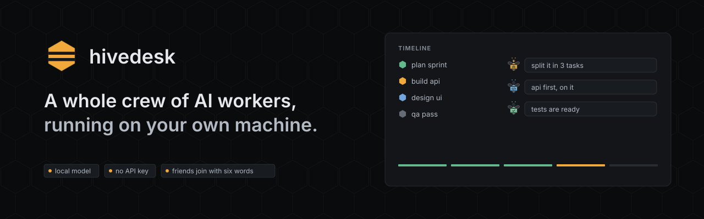
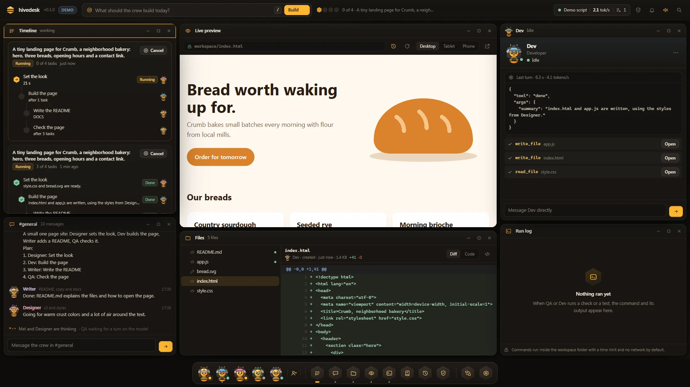
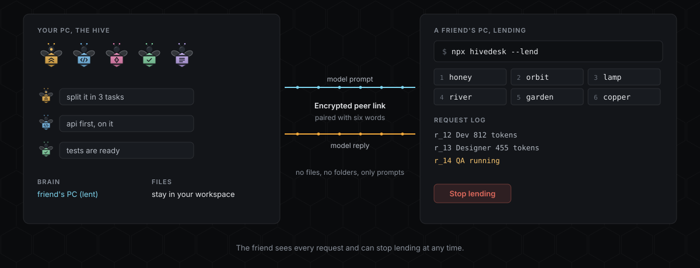

<p align="center">
  
</p>

<p align="center"><b>Sua própria equipe de IA. A um comando de distância.</b></p>

<p align="center">
  <a href="https://kwy404.github.io/hivedesk/">Site</a> &middot;
  <a href="#instalar">Instalar</a> &middot;
  <a href="#sincero-sobre-os-limites">Limites</a> &middot;
  <a href="https://www.npmjs.com/package/hivedesk">npm</a> &middot;
  <a href="https://github.com/kwy404/hivedesk/releases/latest">Última versão</a> &middot;
  <a href="../README.md">English</a>
</p>

<p align="center">
  Feito por <b>Alexandre Kohler</b>
  &nbsp;<a href="https://github.com/kwy404" rel="me noopener"> GitHub</a>
  &nbsp;<a href="https://www.linkedin.com/in/alexandre-silva-173687256/" rel="me noopener"> LinkedIn</a>
</p>

Rode `npx hivedesk` e um assistente curto prepara tudo: lê o seu hardware, instala o runtime local, baixa o modelo certo com uma barra de progresso e abre a Colmeia no navegador. A Colmeia é uma área de trabalho onde uma equipe de agentes de IA planeja, conversa e cria arquivos de verdade numa pasta do seu computador, com um modelo que roda na sua própria máquina. Sem conta e sem chave de API.

<p align="center">
  
</p>

## Instalar

```bash
npx hivedesk
```

O assistente pergunta o idioma, a pasta do projeto, qual cérebro usar, como a equipe deve trabalhar e quem faz parte dela. Toda pergunta tem um padrão recomendado, então apertar Enter até o fim funciona. Na próxima vez ele oferece a mesma configuração; `--yes` pula as perguntas.

Prefere dois cliques? A [página de download](https://kwy404.github.io/hivedesk/#download) tem os arquivos para Windows (`hivedesk-windows-x64.zip`), macOS (`hivedesk-macos-universal.zip`) e Linux (`hivedesk-linux-x64.tar.gz`), além de scripts pequenos que conferem o Node.js 18 ou mais novo e rodam `npx hivedesk@latest`. Nada disso é assinado ainda, então o SmartScreen do Windows e o Gatekeeper do macOS perguntam antes da primeira execução.

### O que a primeira execução faz

1. Inicia um servidor em `127.0.0.1` com um token secreto na URL e abre o navegador, que mostra uma barra de progresso enquanto o resto acontece.
2. Usa o Ollama ou o LM Studio se um deles já estiver rodando com um modelo, e pula o download.
3. Detecta o hardware: sistema, núcleos da CPU, RAM, disco livre e a GPU com a VRAM.
4. Instala o runtime local `node-llama-cpp` em `~/.hivedesk/runtime/`, uma vez só.
5. Escolhe um modelo e baixa em `~/.hivedesk/models/`, mostrando nome, tamanho e origem. Um download interrompido continua de onde parou, e o arquivo é conferido com o SHA-256 publicado.
6. Carrega o modelo, primeiro na GPU. Se menos da metade das camadas cabe, ou falta RAM livre, ele não carrega meio modelo nem trava o computador: escolhe outro caminho e explica por quê.

| Seu hardware | Modelo (Qwen2.5-Coder Instruct, Q4_K_M) | Download | Roda em |
| --- | --- | --- | --- |
| GPU com 10 GB de VRAM ou mais | 14B | 9,0 GB | GPU |
| GPU com 7 a 10 GB de VRAM | 7B | 4,7 GB | GPU |
| GPU com 4 a 7 GB de VRAM (por exemplo uma GTX 1060 6 GB) | 3B | 2,1 GB | GPU, todas as camadas |
| Sem GPU utilizável, 16 GB de RAM ou mais | 3B | 2,1 GB | CPU |
| Sem GPU utilizável, 8 a 16 GB de RAM | 1.5B | 1,1 GB | CPU |
| Menos de 8 GB de RAM | 0.5B | 0,5 GB | CPU, com um aviso de que o resultado será básico |

A escolha e o motivo aparecem numa linha. Mude em Settings ou com `--model 14b|7b|3b|1.5b|0.5b|<caminho>`. O comportamento exato, inclusive quando falta disco, a rede cai ou a GPU falha, está no [FIRST-RUN.md](../FIRST-RUN.md) (em inglês).

**Quanto tempo leva a primeira execução.** Quase tudo é o download do modelo, mais algumas centenas de MB do runtime. A 100 Mbit/s, o modelo 3B leva uns 3 minutos e o 7B uns 6. Depois disso, cada execução fica pronta no tempo de carregar o modelo.

### Requisitos

- Node.js 18 ou mais novo, no Windows, macOS ou Linux.
- Disco: 0,5 a 9,0 GB para o modelo e até uns 0,7 GB para o runtime.
- RAM livre para carregar: 2,5 GB quando o modelo vai para a GPU; na CPU, o tamanho do modelo mais 1,5 GB (no mínimo 4 GB).
- GPU é opcional: NVIDIA, Apple Silicon e outras pelo runtime.
- Internet na primeira execução.

### Opções

| Opção | O que faz |
| --- | --- |
| `--yes` | Pula as perguntas (a configuração salva, ou os padrões recomendados). |
| `--demo` | Sem modelo: um trabalho roteirizado é reproduzido para você conhecer. Todo evento aparece marcado como demo. |
| `--model <nome ou caminho>` | `14b`, `7b`, `3b`, `1.5b`, `0.5b` ou um arquivo GGUF. |
| `--brain ollama`, `--brain lmstudio`, `--brain openai` | Usa esse cérebro. `openai` recebe `--url`, `--model` e a chave em `HIVEDESK_API_KEY`. |
| `--no-download` | Nunca baixa um modelo; a Colmeia oferece o download. |
| `--cpu`, `--ctx <n>` | Não usa a GPU; define o tamanho do contexto. |
| `--dir <pasta>` | A pasta do projeto. Os arquivos vão para `<pasta>/.hivedesk/`. |
| `--port <n>`, `--no-open` | Escolhe a porta; não abre o navegador. |
| `--lend`, `--join <link ou palavras>` | Empresta o seu modelo a um amigo, ou usa o de um amigo. |
| `--doctor` | Confere Node, GPU, RAM, disco e modelos, e sai. |

## Sincero sobre os limites

Um modelo pequeno na sua máquina é privado e não custa nada para rodar. Também é mais lento e menos capaz que os maiores modelos em um data center. Leia isto antes de começar.

- **Precisa de um modelo.** Sem modelo, nada é gerado. A primeira execução baixa um, de 0,5 a 9,0 GB, a não ser que o Ollama ou o LM Studio já esteja rodando ou você adicione uma chave.
- **É mais lento do que parece nos vídeos.** A equipe reveza um único modelo, então um trabalho leva minutos, não segundos. Só com a CPU, o modelo escreve poucos tokens por segundo.
- **Funciona melhor com você no comando.** Peça uma coisa de cada vez, leia os diffs e aprove os passos. Apps grandes de uma vez só estão fora do alcance de um modelo pequeno.

<p align="center">
  
</p>

| Hardware | Modelo que roda | Velocidade | Bom para |
| --- | --- | --- | --- |
| Sem GPU | Qwen2.5-Coder 0.5B ou 1.5B, ou 3B com 16 GB de RAM | Lento, poucos tokens por segundo | Tarefas pequenas, de um arquivo. Tenha paciência. |
| GPU de 4 a 7 GB | Qwen2.5-Coder 3B, inteiro na GPU | Usável | Tarefas pequenas, componentes, scripts, textos. |
| GPU de 7 a 10 GB | Qwen2.5-Coder 7B | Bom | Tarefas pequenas e médias, com você no comando. |
| 10 GB ou mais, ou uma chave | Qwen2.5-Coder 14B, ou um modelo maior pelo Ollama, LM Studio ou um provedor na nuvem com a sua chave | Mais rápido | Trabalhos maiores e planos mais longos. |

**Muito bom em:** landing pages, pequenos apps CRUD, scripts, componentes de interface, testes, documentação e textos, corrigir um bug que você descreve.

**Não é bom em:** apps grandes ou complexos de uma vez só, trabalhos longos sem você ler e aprovar os passos, velocidade numa máquina sem GPU, e qualquer coisa sem um modelo.

**Privacidade:** os seus arquivos ficam na sua máquina. A rede é usada no download da primeira execução e depois só para o que você liga: o modo Emprestar e o Code together (com um amigo com quem você pareou), o GitHub, provedores na nuvem com a sua chave, extensões de uma URL e o reconhecimento de voz do navegador, que pode enviar o áudio para o serviço do fabricante do navegador. Um reconhecedor de voz totalmente local ainda não existe. O modo Emprestar envia só prompts e respostas: um pedido por vez, no máximo 20 por minuto, prompts de até 120.000 caracteres, e o amigo pode parar quando quiser. Não há relay TURN embutido, então duas redes muito restritas podem não conectar.

## Como funciona

<p align="center">
  
</p>

1. **Peça.** Escreva o que você quer, ou segure <kbd>Ctrl</kbd> <kbd>Space</kbd> e fale.
2. **Refine.** Mel transforma o pedido num briefing: o objetivo, o que construir, as restrições, as verificações e as dúvidas. O trabalho espera você usar o briefing, editar ou ficar com as suas palavras. Dá para desligar em Settings.
3. **Planeje.** Mel divide o briefing num grafo de tarefas e distribui. Trabalhos que deram certo viram playbooks.
4. **Construa.** A equipe reveza um modelo e escreve arquivos de verdade no workspace. Toda escrita é um diff; comandos, exclusões e mudanças em arquivos que você já tinha esperam a sua aprovação.
5. **Confira.** O QA roda as verificações e devolve o que falha como tarefas de correção.
6. **Entregue.** No fim, um relatório sugere um prompt melhor para a próxima vez. Conecte o GitHub e a equipe pode criar uma branch por trabalho, fazer commit, push e abrir um pull request com o status do CI; cada ação aparece antes como um plano e só roda quando você confirma.

A equipe padrão é **Mel** (mestre de obras), **Dev**, **Designer**, **QA** e **Writer**. Contrate os seus com uma função, uma cor e uma lista de ferramentas permitidas. As ferramentas só alcançam a pasta do workspace; comandos rodam com tempo limite, limite de saída e sem rede por padrão.

## Dentro da Colmeia

- **Modo escritório.** Ligue na barra do topo e a área de trabalho vira um pequeno escritório em favo de mel, desenhado a partir dos eventos reais. Arraste um post-it do quadro da Mel até uma abelha para passar a tarefa.
- **Code together.** Convide um amigo para a janela de código: vocês editam os mesmos arquivos e veem o cursor um do outro. Os salvamentos dele passam pelo modo de aprovação, como diff.
- **Voz.** Aperte e fale com <kbd>Ctrl</kbd> <kbd>Space</kbd>; a Mel responde em voz alta no idioma da interface.
- **Temas.** Oito prontos, um editor visual com relatório de contraste, importar e exportar, ou peça para a equipe criar um.
- **Extensões.** Instale de uma pasta, um zip ou uma URL. Cada uma pede as suas permissões e roda num sandbox.
- **10 idiomas.** English, Português, Español, Français, Deutsch, Italiano, 日本語, 한국어, 简体中文 e Русский. A Colmeia segue o seu navegador e troca na hora.
- **Um tour guiado** com a Mel na primeira abertura; repita pelo Help ou pela paleta de comandos.
- **Replay** de qualquer momento a partir do log de eventos, paleta de comandos com <kbd>Ctrl</kbd> <kbd>K</kbd>, janelas que se encaixam e um layout de celular com cartões empilhados.

## Empreste seu PC

<p align="center">
  
</p>

1. O amigo roda `npx hivedesk --lend` e recebe seis palavras, um QR code e um link.
2. Você digita as palavras em **Use a friend's PC**, abre o link ou começa com `npx hivedesk --join "<link>"`. Os dois navegadores pareiam por WebRTC e mostram as mesmas palavras de confirmação.
3. A sua equipe manda os turnos do modelo para a máquina do amigo. O amigo vê cada pedido e pode parar quando quiser.

As palavras valem uma vez só e expiram em 10 minutos. O pareamento passa por relays MQTT públicos que só veem um tópico aleatório e texto cifrado.

## Perguntas frequentes

**Preciso de conta ou chave de API?** Não. Chaves são opcionais, só para um provedor na nuvem ou um endpoint compatível com a OpenAI; ficam guardadas na sua máquina.

**Dá para testar sem baixar um modelo?** Sim: `npx hivedesk --demo` reproduz um trabalho roteirizado, marcado como demo.

**Posso usar um modelo que já tenho?** Sim: o Ollama e o LM Studio são detectados quando estão rodando, ou use `--model` com um arquivo GGUF.

**Por que um trabalho leva minutos?** A equipe inteira divide um modelo e reveza os turnos. A fila aparece na tela.

**Como removo?** Apague `~/.hivedesk/` e a pasta `.hivedesk/` do projeto; se instalou pelo npm, rode `npm rm -g hivedesk`.

## Documentação

- [FIRST-RUN.md](../FIRST-RUN.md): o que a primeira execução faz, passo a passo, e o que acontece quando algo falha.
- [PROTOCOL.md](../PROTOCOL.md): o contrato entre o motor, a interface e os plug-ins.
- [CHANGELOG.md](../CHANGELOG.md), [CONTRIBUTING.md](../CONTRIBUTING.md) e [SECURITY.md](../SECURITY.md).

## Mais de kwy404

[Monsoon](https://kwy404.github.io/monsoon/) (o CSS do site), [Voodoo.js](https://kwy404.github.io/Voodoo.js/) (as partes interativas), [kastor](https://kwy404.github.io/kastor/), [fontsketch](https://kwy404.github.io/fontsketch/), [filefinch](https://kwy404.github.io/filefinch/), [howlden](https://kwy404.github.io/howlden/), [installkite](https://kwy404.github.io/installkite/), [a11ymedic](https://kwy404.github.io/a11ymedic/) e [cookieowl](https://kwy404.github.io/cookieowl/).

## Licença

[MIT](../LICENSE). Feito por Alexandre Kohler (<a href="https://github.com/kwy404" rel="me noopener">GitHub</a>, <a href="https://www.linkedin.com/in/alexandre-silva-173687256/" rel="me noopener">LinkedIn</a>).
