<p align="center">
  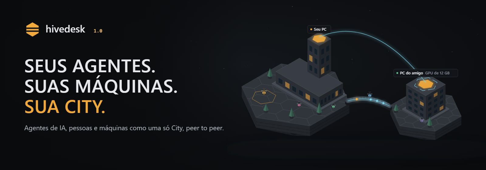
</p>

<p align="center"><a href="https://kwy404.github.io/hivedesk/pt-BR/#film">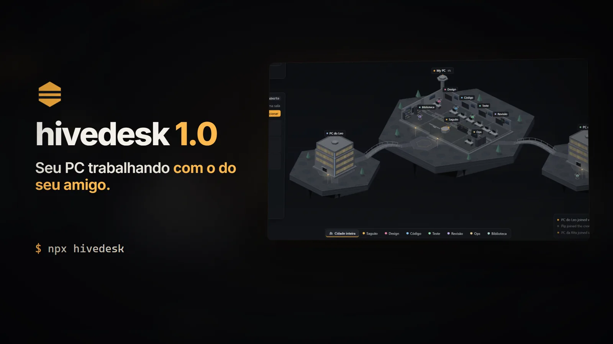</a><br><sub><a href="https://kwy404.github.io/hivedesk/pt-BR/#film">Assista ao filme da 1.0, 3:50</a></sub></p>


<h3 align="center">Seus agentes. Suas máquinas. Sua cidade.</h3>

<p align="center"><b>O hivedesk é um ambiente operacional peer-to-peer em que agentes de IA, pessoas e máquinas trabalham juntos como uma só City.</b></p>

<p align="center">
  <a href="https://kwy404.github.io/hivedesk/pt-BR/"><b>Site</b></a> &middot;
  <a href="#comecar">Começar</a> &middot;
  <a href="#app-ou-navegador">App ou navegador</a> &middot;
  <a href="#seguranca">Segurança</a> &middot;
  <a href="#limites">Limites</a> &middot;
  <a href="../README.md">English</a>
</p>

<p align="center">
  <a href="https://www.npmjs.com/package/hivedesk"></a>
  <a href="https://github.com/kwy404/hivedesk/releases/latest"></a>
  <a href="../LICENSE"></a>
  
</p>

O seu PC é o primeiro prédio da sua City. Os amigos entram com seis palavras e trazem as máquinas deles. Os agentes moram nas salas, pegam as tarefas e pensam na máquina que o agendador escolher: a sua GPU, a GPU que um amigo decidiu compartilhar ou a sua CPU, sempre dentro do que cada dono permitiu e com um motivo que você consegue ler. Os modelos rodam nas suas próprias máquinas; sem conta e sem chave de API.

| | |
| --- | --- |
| **O seu PC** | O motor, o seu espaço de trabalho, os seus agentes e o seu próprio modelo. |
| **O PC de um amigo** | Um prédio na sua City, com os agentes dele. Não compartilha nada até o dono dizer que sim. |
| **Agentes** | Arquiteto, Desenvolvedor, QA e Revisor por padrão, cada um com uma sala, ferramentas, um nível e uma memória. |
| **GPU e CPU** | Emprestadas por trabalho, com uma concessão temporária, limites e um botão Parar, separadamente para a GPU e a CPU. |
| **P2P** | Identidades Ed25519, convites de seis palavras, palavras de conferência, criptografia de ponta a ponta e um registro de auditoria. |

<table>
  <tr><td align="center" width="16%"><br><sub>Uma equipe de agentes</sub></td><td align="center" width="16%"><br><sub>A sua City</sub></td><td align="center" width="16%"><br><sub>Máquinas</sub></td><td align="center" width="16%"><br><sub>Convites de seis palavras</sub></td><td align="center" width="16%"><br><sub>Compartilhe a GPU</sub></td><td align="center" width="16%"><br><sub>Compartilhe a CPU</sub></td></tr>
  <tr><td align="center" width="16%"><br><sub>Tela remota</sub></td><td align="center" width="16%"><br><sub>Área de transferência e arquivos</sub></td><td align="center" width="16%"><br><sub>É só falar</sub></td><td align="center" width="16%"><br><sub>Editor de código</sub></td><td align="center" width="16%"><br><sub>Playbooks</sub></td><td align="center" width="16%"><br><sub>Registro de auditoria</sub></td></tr>
</table>

<p align="center">
  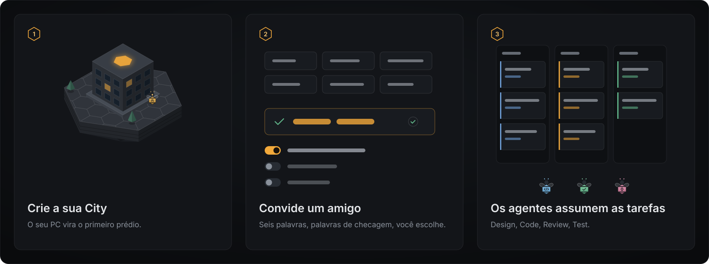
</p>

<a id="comecar"></a>
## Começar

```bash
npx hivedesk            # o motor na sua máquina, a janela no seu navegador
npx hivedesk --demo     # conheça antes: uma City numa pasta temporária, com cada evento marcado
```

Ou baixe o app de desktop (recomendado, abaixo): ele traz o próprio Node.js e oferece a experiência completa.

<a id="app-ou-navegador"></a>
### App de desktop ou navegador

O app de desktop e o `npx hivedesk` rodam o mesmo motor na sua máquina; o que muda é a janela. Uma página da web sozinha roda dentro da área isolada do navegador, então não consegue fazer nada disto.

| Recurso | App de desktop (recomendado) | Aba do navegador com `npx hivedesk` | Só o navegador, nada instalado |
| --- | --- | --- | --- |
| O modelo local na sua GPU | Sim | Sim. O motor roda em Node.js na sua máquina; a aba só mostra. | Não. Uma página da web não consegue iniciar um programa nativo nem carregar do seu disco um arquivo de modelo de vários GB. |
| Compartilhar a sua GPU e CPU | Sim, até com a janela fechada: ele continua na bandeja do sistema. | Sim, enquanto a aba ficar aberta. A conexão com os amigos roda na janela, e os navegadores deixam lentas ou congelam as abas em segundo plano. | Não. Não há motor para compartilhar. |
| Controle remoto | Windows, e Linux com X11. No macOS é só visualização até o app ser assinado. | Ver funciona em navegadores baseados no Chromium. O controle, a área de transferência nativa e os arquivos colados vêm do auxiliar de entrada, igual ao app. | Não. Uma página não consegue mover o mouse nem apertar teclas no seu sistema. |
| Trocar de monitor | Sim. Quem vê pede, quem compartilha escolhe a tela. | Sim, mas o navegador pede a quem compartilha que escolha a tela no próprio diálogo, toda vez: uma página nunca pode escolher a tela sozinha. | Não |
| Terminal (PTY) | Sim no Windows e no macOS. No Linux quando a parte nativa compila; senão, um terminal básico identificado. | O mesmo: o terminal roda no motor. | Não. Uma página não consegue abrir um shell. |
| Acesso aos arquivos | As pastas que você adicionar, com o seletor de pastas nativo. | As mesmas pastas. Você digita o caminho, porque a página não tem seletor de pastas nativo. | Só os arquivos que você escolher ou arrastar, um de cada vez, como mandam as regras do navegador. |
| <kbd>Ctrl</kbd> <kbd>Alt</kbd> <kbd>Del</kbd> | Nunca é enviado a uma máquina remota. O Windows reserva essa combinação para a tela segura de entrada, então o hivedesk descarta ela, e o Win+L, de propósito. | Nunca é enviado. O seu próprio sistema também captura antes de qualquer página ver. | Não |
| Notificações | Notificações do sistema, pelo app. | Depois que você permitir no navegador, e só com a aba aberta; senão, dentro da página. | Não |
| Rodar em segundo plano | Sim. Feche a janela e ele fica na bandeja, com Abrir, Pausar e Sair. | O motor continua rodando no terminal, mas os amigos precisam da aba aberta, e uma aba dormindo pode travar um trabalho emprestado. | Não. Fechar a aba encerra tudo. |

No macOS e no Linux, o compartilhamento de tela abre no seu navegador baseado no Chromium, porque o componente web desses sistemas não captura a tela de forma confiável.

### Baixar

| | Arquivo | Como abrir |
| --- | --- | --- |
| Windows 10 e 11, x64 | [hivedesk-setup.exe](https://github.com/kwy404/hivedesk/releases/latest/download/hivedesk-setup.exe) | execute: ele instala para o seu usuário, sem direitos de administrador, e baixa o app |
| Windows, offline | [hivedesk-setup-offline.exe](https://github.com/kwy404/hivedesk/releases/latest/download/hivedesk-setup-offline.exe) | o mesmo instalador com o app dentro, para uma máquina sem rede |
| macOS, Apple Silicon e Intel | [hivedesk-macos.dmg](https://github.com/kwy404/hivedesk/releases/latest/download/hivedesk-macos.dmg) | abra, arraste o hivedesk para Aplicativos e abra |
| Linux x64, arquivo único | [hivedesk-linux-x86_64.AppImage](https://github.com/kwy404/hivedesk/releases/latest/download/hivedesk-linux-x86_64.AppImage) | `chmod +x` e execute |
| Linux x64, script de instalação | [hivedesk-linux-install.sh](https://github.com/kwy404/hivedesk/releases/latest/download/hivedesk-linux-install.sh) | `sh hivedesk-linux-install.sh`: confere o SHA-256 com o `SHA256SUMS.txt` e instala em `~/.local` sem root |
| Debian e Ubuntu | `hivedesk_<versão>_amd64.deb` na [página de versões](https://github.com/kwy404/hivedesk/releases/latest) | `sudo apt install ./hivedesk_<versão>_amd64.deb` |
| Fedora e outros sistemas RPM | `hivedesk-<versão>-1.x86_64.rpm` na [página de versões](https://github.com/kwy404/hivedesk/releases/latest) | `sudo dnf install ./hivedesk-<versão>-1.x86_64.rpm` |
| Qualquer sistema com Node.js 20+ | `npx hivedesk` | a janela abre no seu navegador |

Os apps instalados se atualizam sozinhos. Primeiro eles conferem a assinatura Ed25519 do manifesto de atualização, depois perguntam: Atualizar agora, Ao fechar ou Lembrar depois. Os pacotes `.deb` e `.rpm` mostram o comando de atualização, e `npx hivedesk@latest` pega a versão mais nova. Os instaladores não têm assinatura de código com certificados pagos, então o SmartScreen do Windows ("Mais informações", depois "Executar assim mesmo") e o Gatekeeper do macOS (Ajustes do Sistema, Privacidade e Segurança, "Abrir Mesmo Assim") perguntam uma vez. Um modelo só é baixado depois que você disser sim. Tamanhos e o `SHA256SUMS.txt` estão na [página de versões](https://github.com/kwy404/hivedesk/releases).

<p align="center">
  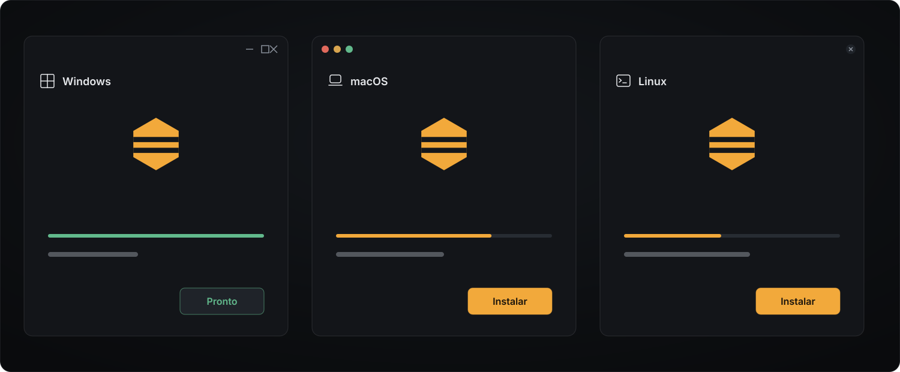
</p>

## A City

<p align="center">
  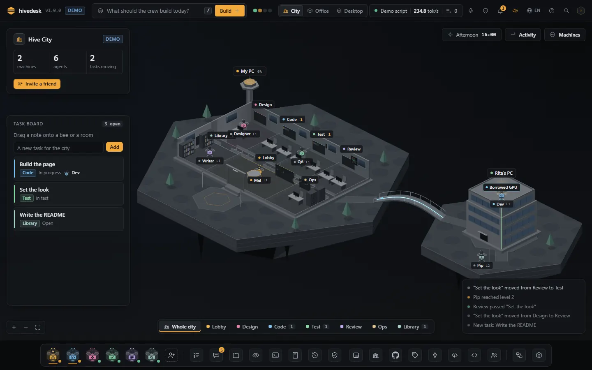
</p>

<table>
  <tr>
    <td width="33%">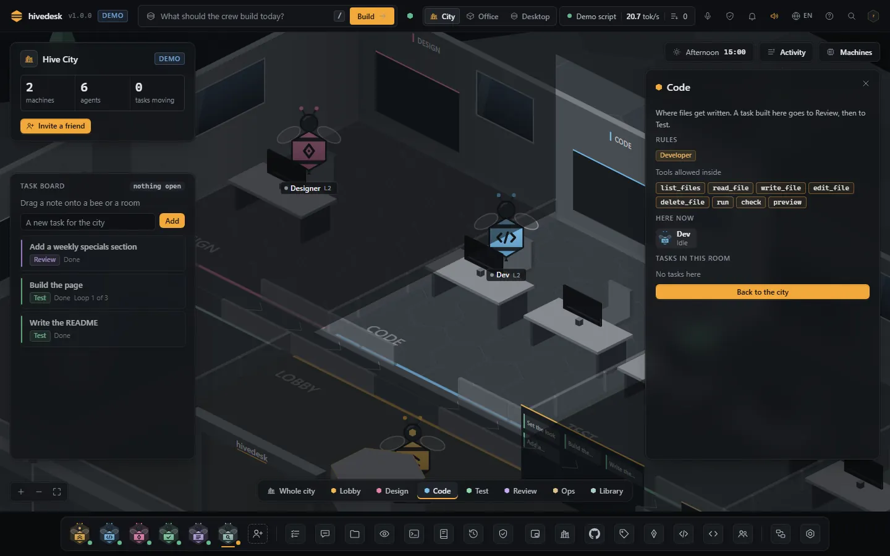<br><sub><b>Salas com regras:</b> as ferramentas permitidas, quem está lá, as tarefas.</sub></td>
    <td width="33%">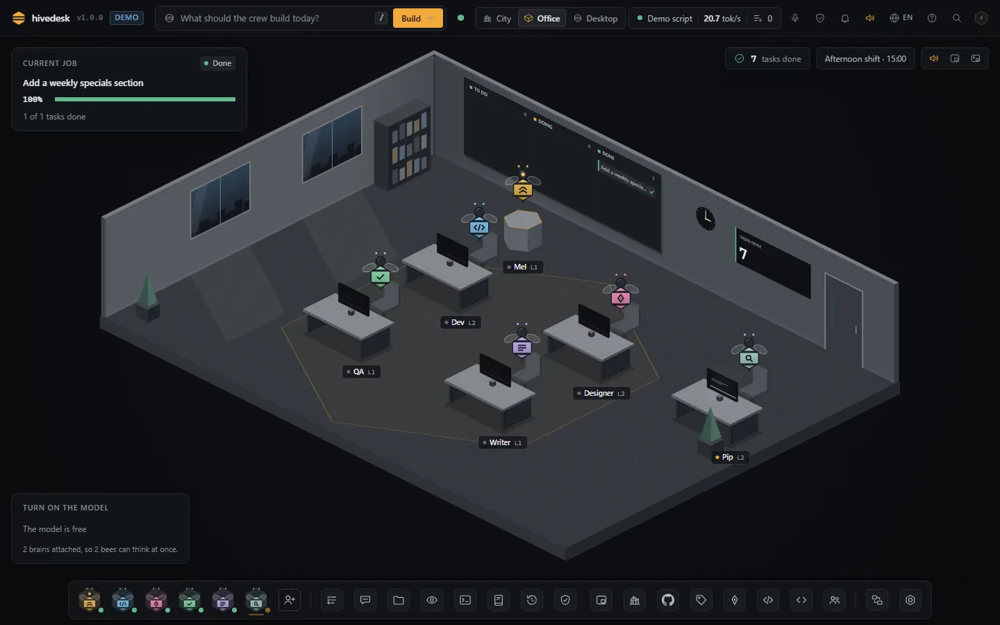<br><sub><b>O Office:</b> os mesmos eventos por dentro, com a contagem de tarefas terminadas.</sub></td>
    <td width="33%">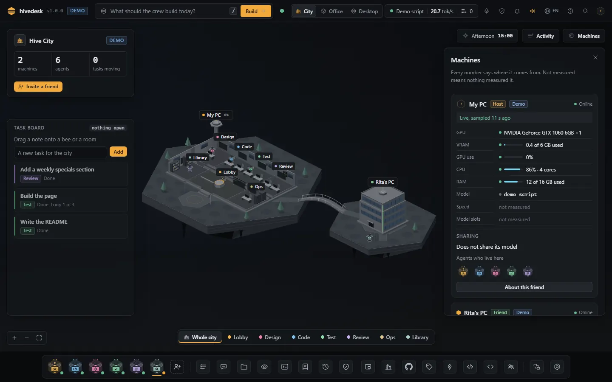<br><sub><b>Máquinas:</b> todo número tem origem, ou diz que não foi medido.</sub></td>
  </tr>
  <tr>
    <td width="33%">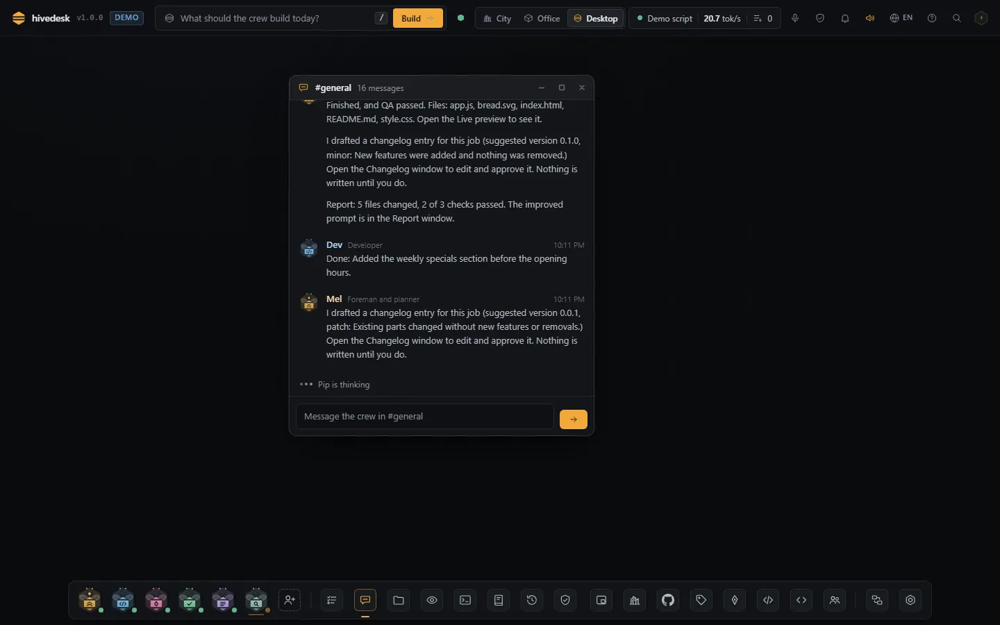<br><sub><b>Chat:</b> a equipe dá notícias no #general e em mensagens diretas.</sub></td>
    <td width="33%">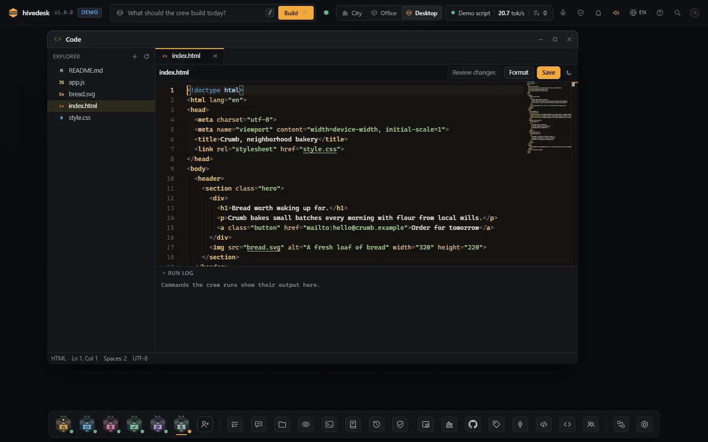<br><sub><b>Editor de código:</b> explorador, abas, formatar, salvar e o registro de execução.</sub></td>
    <td width="33%">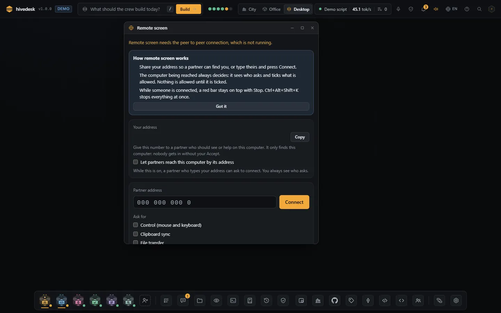<br><sub><b>Tela remota:</b> nada é permitido até ser marcado.</sub></td>
  </tr>
  <tr>
    <td width="33%">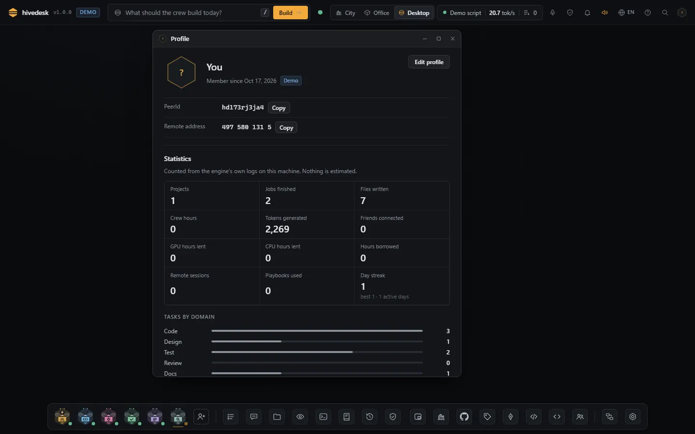<br><sub><b>Perfil:</b> estatísticas dos seus próprios registros, nada estimado.</sub></td>
    <td width="33%">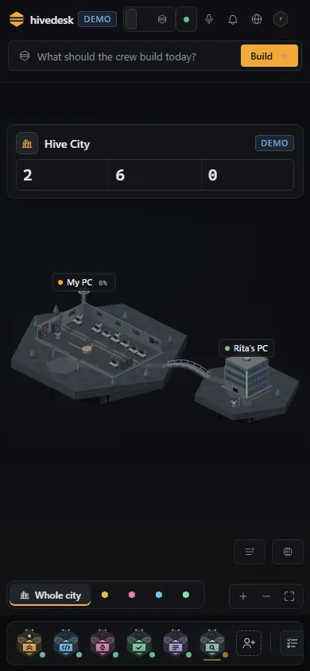<br><sub><b>No celular:</b> a City numa janela de 390 px.</sub></td>
    <td width="33%">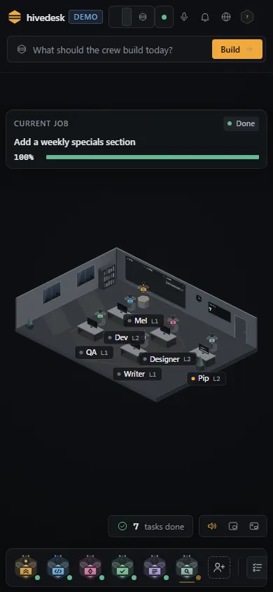<br><sub><b>O Office</b> na mesma tela estreita.</sub></td>
  </tr>
</table>

A City é o estado do sistema: prédios são máquinas, salas são lugares com as próprias ferramentas, e cada tarefa passa pelas salas até ficar pronta. Todo número que aparece nela é medido, ou o painel diz que não foi medido.

## Criar uma City

1. Abra o hivedesk (o app, ou `npx hivedesk`). A primeira tela deixa você dar um nome à sua City e escolher: conhecer a demo, usar um modelo que você já roda ou baixar um para o seu hardware, vendo o tamanho, a licença e o tempo estimado antes de qualquer coisa começar.
2. O seu PC vira o primeiro prédio, com as salas Lobby, Design, Code, Review, Test, Ops e Library, e a equipe padrão.
3. `hivedesk city` mostra a City no terminal: prédios, agentes, tarefas por estado e os amigos online.

## Convidar um amigo

1. Clique em **Convidar um amigo** na City, ou rode `hivedesk invite`. Você recebe seis palavras. Elas valem uma vez, por 10 minutos.
2. O seu amigo abre **Entrar** e digita as palavras (ou `hivedesk join "seis palavras"`). As palavras se encontram por um relay e montam uma sessão criptografada.
3. As duas telas mostram as mesmas **palavras de conferência**. Se forem iguais, você escolhe o que o seu amigo pode fazer: só **Ver a City** vem marcado; trazer um prédio e agentes, usar a sua GPU ou ler o espaço de trabalho são opções separadas.
4. Aceite. O prédio dele sobe ao lado do seu. `hivedesk peers` lista os amigos conhecidos e as permissões deles, com `--revoke` e `--block`.

Uma palavra errada queima o convite no primeiro handshake: é só criar outro. O terminal pareia pela rede local (`hivedesk invite --lan`); pela internet, é preciso uma janela.

## Usar a GPU de um amigo

1. O dono liga o compartilhamento, separado para a GPU e para a CPU, com limites, no app ou com `hivedesk share --gpu on --max-vram 8GB --max-jobs 1 --max-seconds 120`. O compartilhamento vem desligado.
2. O dono libera computação para você (a opção **Usar a minha GPU** na entrada, ou depois).
3. Quando um modelo não cabe na sua máquina, o agendador oferece o trabalho à GPU do seu amigo, explica a escolha em uma frase e mantém uma concessão de 15 segundos, renovada a cada sinal de vida. Os turnos do próprio dono sempre vêm primeiro.
4. Qualquer um dos dois pode parar. Um trabalho parado guarda a resposta parcial, e o cartão do trabalho oferece Tentar de novo aqui, Tentar outro amigo, Usar o parcial ou Cancelar.

<p align="center">
  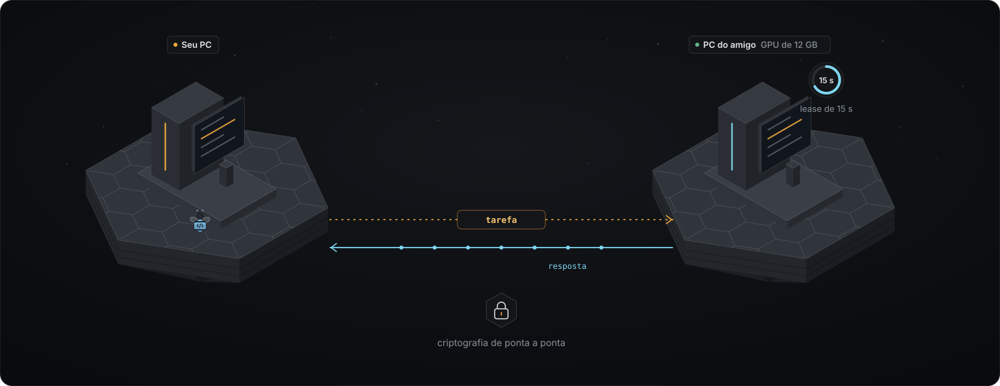
</p>

## Criar um agente

Abra **Contratar** no dock e dê ao agente um nome, uma função e, se quiser, um prompt e uma especialização. Ele ganha uma sala de origem para a função, um nível que cresce com o trabalho concluído, as ferramentas da sala em que estiver trabalhando e uma memória privada que você pode ler, editar e fixar. Os agentes ficam salvos na sua máquina e voltam amanhã. Os agentes de um amigo começam só com ferramentas de leitura e pensam na máquina dele.

## Rodar uma tarefa

Escreva o que você quer na caixa de pedido, na caixa da City, no `#general` ou numa mensagem direta para um agente, ou segure <kbd>Ctrl</kbd> <kbd>Espaço</kbd> e fale. A Mel transforma o pedido num briefing e num grafo de tarefas; cada tarefa segue o fluxo Design, Code, Test, Review. O QA roda o `npm test` do seu projeto quando existe um script de teste, e as verificações estáticas nos outros casos. Uma falha volta para o autor com os problemas, no máximo 3 vezes. Comandos, exclusões e respostas vindas de outra máquina esperam a sua aprovação.

<table>
  <tr>
    <td width="40%"><br><sub>Segure <kbd>Ctrl</kbd> <kbd>Espaço</kbd> e fale.</sub></td>
    <td width="60%">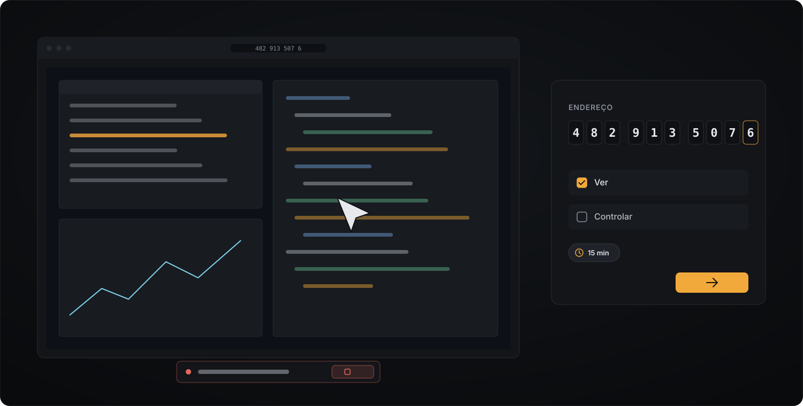<br><sub>Um endereço de 10 dígitos, só visualização até o controle ser marcado.</sub></td>
  </tr>
</table>

<p align="center">
  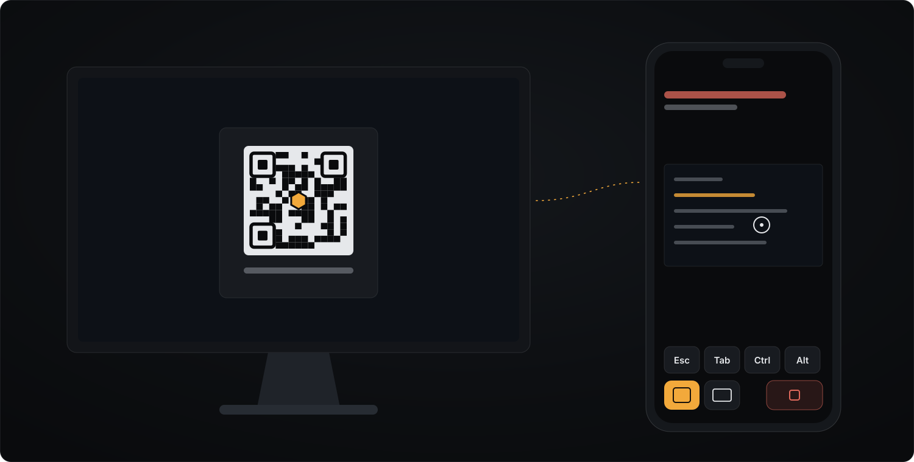<br>
  <sub><b>Controle pelo celular:</b> escaneie o QR code na janela do hivedesk e depois aprove, converse e acompanhe os trabalhos pelo celular. Cada celular tem as próprias permissões.</sub>
</p>

## Como funciona

<details>
<summary><b>Arquitetura</b></summary>

```text
 janela (app ou aba)  <->  motor do hivedesk (Node.js 20, 127.0.0.1, token secreto)
                             core: um log de eventos por projeto, reducers por domínio, roteador de comandos com verificação
                             tasks: um motor de tarefas, nove estados, histórico, repetir, cancelar, reatribuir
                             equipe e City: agentes, salas, fluxo
                             p2p: identidade, convites, sessões, permissões, registro de auditoria
                             compute: medições, compartilhamento, agendador, concessões, worker
                             workbench: arquivos, busca, terminal, controle de versão
                             remote: ver e controlar a tela, área de transferência, arquivos
                                   |  quadros criptografados: no processo, na rede local ou pela janela
                             outros motores do hivedesk
```

O motor é quem decide: chaves de identidade, sessões, permissões, trabalhos e o registro de auditoria ficam no Node.js, nunca numa aba do navegador. Protocolos: [PROTOCOL.md](../PROTOCOL.md), [CITY-PROTOCOL.md](../CITY-PROTOCOL.md) e [docs/1.0/protocol/](../docs/1.0/protocol/) (em inglês).
</details>

<details>
<summary><b>P2P</b></summary>

- Uma identidade Ed25519 por instalação, em `~/.hivedesk/identity/`. O id vem da chave pública e aparece para as pessoas como seis palavras.
- Convites: seis palavras (66 bits), um uso, 10 minutos, queimados pelo primeiro handshake que começar. O handshake usa X25519 com o convite como chave pré-compartilhada, as duas identidades assinam a conversa e as duas telas mostram seis palavras de conferência antes de quem convidou aceitar.
- Sessões: ChaCha20-Poly1305 com canais separados para controle, computação e mídia, troca de chave a cada 2^20 mensagens ou 60 minutos, janela contra repetição e um ping a cada 5 segundos.
- Transportes: rede local (desligada até você ligar) e o canal de dados da janela por relays públicos que só transportam texto cifrado. Amigos conhecidos reconectam sem palavras.
- `hivedesk doctor --p2p` verifica a identidade, os relays, as portas e o tipo da sua rede (aberta, cone, simétrica ou bloqueada).
</details>

<a id="seguranca"></a>
<details>
<summary><b>Segurança</b></summary>

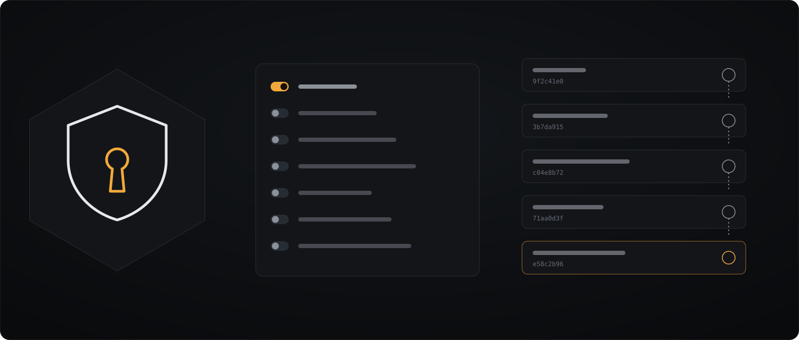

- **Tudo negado por padrão.** Quando um amigo entra, só Ver a City vem ligado. Fazer parte da City, computação (GPU, CPU, RAM, armazenamento), o espaço de trabalho, compartilhar o terminal, a tela, a área de transferência e arquivos são permissões separadas, com limites. Permissões de tela e de terminal valem só para a sessão, no máximo 60 minutos.
- **Quem decide é o motor do dono.** Cada comando de um amigo é verificado no motor da máquina dona do recurso. Um convidado não consegue escolher o seu modelo, abrir um shell nem ler um arquivo que você não compartilhou.
- **Respostas de outra máquina não são confiáveis.** Qualquer chamada de ferramenta vinda de um turno servido pela GPU de um amigo precisa da sua aprovação em todos os modos, arquivos novos inclusive.
- **Concessões e prazos.** Um trabalho emprestado tem uma concessão de 15 segundos, um prazo final, um limite de tokens e roda só no modelo local de quem empresta, nunca na chave de nuvem dele nem em outro amigo.
- **Registro de auditoria.** `~/.hivedesk/audit/`, uma linha encadeada por hash para cada entrada, permissão, revogação, trabalho e sessão remota. Ele nunca guarda palavras, chaves, prompts ou respostas.
- Para relatar uma vulnerabilidade: [SECURITY.md](../SECURITY.md).
</details>

<details>
<summary><b>Workers de GPU e CPU</b></summary>

- Medições em cada máquina: a ferramenta do fabricante da GPU, os contadores de desempenho do Windows, os arquivos do kernel do Linux e, no macOS, a memória unificada (o uso aparece como não medido). Cada número mostra a sua origem; os números de um amigo aparecem como informados por ele.
- Compartilhamento, desligado por padrão: GPU (VRAM máxima, trabalhos ao mesmo tempo de 1 a 4, duração máxima, inferência remota, download de modelo) e CPU (threads, RAM máxima), além de horário, lista de modelos e quais amigos.
- Um worker serve só o modelo que já está carregado, nunca troca o modelo do dono, nunca baixa um modelo para um amigo e recusa tudo que não seja um trabalho de inferência.
</details>

<details>
<summary><b>Agendador</b></summary>

Para cada trabalho ele lista os candidatos (a sua GPU, a sua CPU, cada amigo que liberou computação para você), descarta os que falham numa regra (permissão, compartilhamento, modelo, memória, capacidade, tempo) com o motivo, estima o tempo pelas velocidades medidas, prefere o trabalho local e escolhe o menor. O motivo aparece numa frase no cartão do trabalho e na ponte da City, por exemplo: "PC da Ana, GPU: o modelo 7B cabe nos 8 GB que ela compartilha, cerca de 14 s. A sua GPU tem 3,2 GB livres e o modelo precisa de 5,4 GB; a sua CPU levaria cerca de 52 s." Sem candidato, a tarefa espera por um recurso e lista os motivos.
</details>

<details>
<summary><b>Agentes e a City</b></summary>

- Agentes: uma função (Arquiteto, Desenvolvedor, QA, Revisor, Planejador, Redator, Designer ou a sua), uma sala de origem, onde pensam (local, num amigo ou numa chave de nuvem), ferramentas e permissões, nível e histórico do trabalho concluído e uma memória de entradas curtas.
- As salas limitam as ferramentas de um agente às da sala enquanto ele trabalha ali. Ops é só para quem hospeda. Extensões podem adicionar salas.
- As tarefas têm nove estados (na fila, atribuída, em andamento, esperando, revisão, testes, concluída, falhou, cancelada), com histórico de cada mudança e um prazo em cada espera.
- O painel Machines, o fluxo de Atividade e os painéis de trabalho, tarefa e amigo leem o mesmo estado. O modo Escritório mostra os mesmos eventos como um escritório em favo de mel.
</details>

<details>
<summary><b>Workbench</b></summary>

Pastas que você adiciona ao lado do espaço de trabalho da equipe (cada uma é uma permissão que você pode remover), um explorador com criar, renomear, mover e excluir, abas em até três grupos divididos, diagnósticos e símbolos para JavaScript e TypeScript, buscar e substituir em todos os arquivos com prévia do diff, um terminal de verdade (Windows e macOS; no Linux quando a parte nativa compila, senão um terminal básico identificado), controle de versão (status, diff, stage, commit, branches, stashes, log), compartilhamento de terminal por 5, 15 ou 60 minutos e Code together pela sessão criptografada. Agentes nunca recebem um terminal.
</details>

<details>
<summary><b>Área de trabalho remota</b></summary>

Um endereço de 10 dígitos (que não é senha) encontra uma máquina enquanto "Permitir que parceiros encontrem este computador" estiver ligado, e isso vem desligado. Quem compartilha vê o nome e as palavras de conferência de quem chama, com uma contagem de 60 segundos; todas as opções começam desmarcadas (ver, controlar, área de transferência, arquivos) e as permissões duram 5, 15 ou 60 minutos. Uma faixa com Parar, <kbd>Ctrl</kbd> <kbd>Alt</kbd> <kbd>Shift</kbd> <kbd>K</kbd> no Windows, nenhuma entrada com a tela bloqueada, várias telas, predefinições de qualidade, chat, texto e imagens na área de transferência, arquivos de até 2 GB que retomam de onde pararam e acesso autônomo para amigos conhecidos com senha (5 tentativas erradas bloqueiam por 15 minutos). O controle funciona no Windows e no Linux X11 com xdotool e loginctl; no macOS e no Wayland é só visualização na 1.0.

O celular também pode ser um controle: pareie com o QR code na janela do hivedesk, aceite no desktop e depois aprove, converse e acompanhe os trabalhos pelo celular. Cada celular tem as próprias permissões (no começo, só o status vem ligado), uma remoção vale na hora, e a janela do hivedesk precisa ficar aberta.
</details>

<details>
<summary><b>Modelos</b></summary>

Um catálogo de 57 modelos de código aberto, de 0.5B a 72B parâmetros, para programação, raciocínio e conversa, cada um em arquivos quantizados de 2 a 8 bits, com as licenças. O hivedesk recomenda um para o seu hardware e pergunta antes de qualquer download. Um medidor mostra o quanto a sua City está perto de rodar um modelo gigante com a memória compartilhada pelos amigos, e uma opção experimental, desligada por padrão, roda um modelo nas máquinas dos amigos que permitiram, pela conexão p2p criptografada. A velocidade depende da conexão de rede entre as máquinas. Cerca de 500 playbooks de especialistas (páginas, componentes, dados, testes, revisões, git e documentação) são escolhidos por relevância para cada tarefa, e as verificações deles rodam no QA.

| Seu hardware | Modelo que roda | Velocidade | Bom para |
| --- | --- | --- | --- |
| Sem GPU | Um modelo de código 0.5B ou 1.5B, ou 3B com 16 GB de RAM | Lento, poucos tokens por segundo | Tarefas pequenas, de um arquivo. Tenha paciência. |
| GPU de 4 a 7 GB | Um modelo de código 3B, inteiro na GPU | Usável | Tarefas pequenas, componentes, scripts, textos. |
| GPU de 7 a 10 GB, ou a de um amigo | Um modelo de código 7B | Bom | Tarefas pequenas e médias, com você no comando. |
| 10 GB ou mais, ou uma chave | Um modelo de código 14B, um maior num runtime local que você já usa, ou um modelo na nuvem com a sua chave | Mais rápido | Trabalhos maiores e planos mais longos. |
</details>

<details>
<summary><b>Desenvolvimento</b></summary>

```bash
git clone https://github.com/kwy404/hivedesk && cd hivedesk
npm install
npm run demo                                          # o motor com uma City roteirizada
npx vitest run --pool=threads --maxWorkers=2          # os testes
npm run lint && npm run rules && npm run site         # as verificações
python docs/_i18n/check.py                            # o site em 10 idiomas
```

Responsabilidades, contratos e o plano de testes estão em [docs/1.0/PLAN.md](../docs/1.0/PLAN.md); o [CONTRIBUTING.md](../CONTRIBUTING.md) tem o resto (em inglês).
</details>

<a id="limites"></a>
## Sincero sobre os limites

- **Os amigos precisam de uma janela.** Pela internet, a conexão com os amigos roda na janela do app ou numa aba do navegador; um par sem janela precisa de uma parte nativa de WebRTC que ainda não existe. Na mesma rede, `hivedesk invite --lan` funciona pelo terminal.
- **Sem relay TURN.** Duas redes muito restritas podem não se conectar; `hivedesk doctor --p2p` diz de que lado está o problema.
- **Ainda sem assinatura.** Os downloads não têm assinatura de código nem notarização, por isso o controle remoto no macOS é só visualização e o seu sistema avisa antes da primeira execução.
- **Um modelo por máquina emprestada.** A máquina de um amigo serve só o modelo que já está carregado e nunca baixa um para outra pessoa.
- **Modelos gigantes são experimentais.** Dividir um modelo entre as máquinas dos amigos pela conexão p2p criptografada está na 1.0, desligado por padrão, e a velocidade depende da conexão de rede entre as máquinas.
- **Modelos pequenos são lentos.** Os workers se revezam num modelo só, então um trabalho leva minutos; só na CPU, poucos tokens por segundo.

## Perguntas frequentes

<details><summary><b>Preciso de conta ou chave de API?</b></summary>Não. Os modelos rodam nas suas próprias máquinas e os amigos se conectam direto com você. Uma chave é opcional, só para um modelo na nuvem que você escolher; ela fica guardada na sua máquina.</details>
<details><summary><b>Um amigo consegue ver os meus arquivos?</b></summary>Só se você marcar Ler o espaço de trabalho para ele. As edições que ele propõe esperam a sua aprovação, arquivos novos inclusive.</details>
<details><summary><b>O que a GPU de um amigo vê quando eu uso?</b></summary>Os prompts e as respostas dos trabalhos enviados a ela, e mais nada: nem arquivos, nem ferramentas, nem memória.</details>
<details><summary><b>Preciso do app de desktop?</b></summary>Não. O <code>npx hivedesk</code> roda o mesmo motor; a <a href="#app-ou-navegador">tabela acima</a> mostra todas as diferenças.</details>
<details><summary><b>Alguém pode tomar conta da minha tela?</b></summary>Não sem o seu clique: desligado por padrão, só visualização por padrão, toda permissão expira, uma tela bloqueada não recebe entrada, e um atalho ou o botão Parar encerra tudo.</details>
<details><summary><b>Como removo?</b></summary>Apague <code>~/.hivedesk/</code> (identidade, amigos conhecidos, runtime, modelos e ajustes) e a pasta <code>.hivedesk/</code> do seu projeto; se instalou pelo npm, rode também <code>npm rm -g hivedesk</code>.</details>

## Documentação

[FIRST-RUN.md](../FIRST-RUN.md) &middot; [PROTOCOL.md](../PROTOCOL.md) &middot; [CITY-PROTOCOL.md](../CITY-PROTOCOL.md) &middot; [docs/1.0/protocol/](../docs/1.0/protocol/) &middot; [CHANGELOG.md](../CHANGELOG.md) &middot; [SECURITY.md](../SECURITY.md) (em inglês)

## Autor

Feito por **Alexandre Kohler** &middot; <a href="https://github.com/kwy404" rel="me noopener"> GitHub</a> &middot; <a href="https://www.linkedin.com/in/alexandre-silva-173687256/" rel="me noopener"> LinkedIn</a>

[MIT](../LICENSE). A janela de desktop usa o [Neutralinojs](https://neutralino.js.org/) (MIT).
